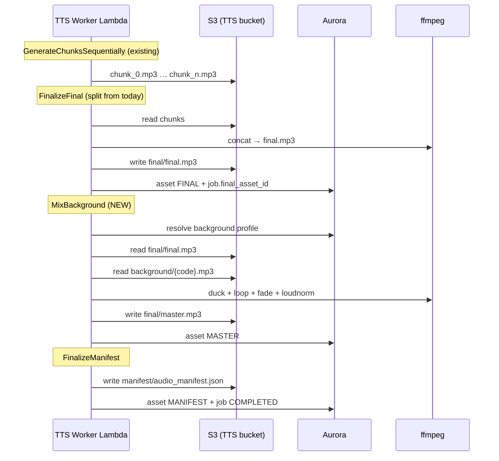

# Background Audio Mixing — Implementation Guide

> **Status:** planned (not yet implemented)  
> **Authority:** Read after [`architecture-and-tts-plane.md`](architecture-and-tts-plane.md) and [`tts-plane-phase-map.md`](tts-plane-phase-map.md)  
> **Scope:** TTS plane finalizer stage only — downstream of narration synthesis  
> **Related:** [`phase-tts-0-boundary.md`](phase-tts-0-boundary.md) · Phase 11 finalization notes in [`tts-plane-phase-map.md`](tts-plane-phase-map.md#12-phase-11--finalization-and-manifest)

This document is the **Cursor-ready implementation spec** for adding a curated background-audio bed under completed TTS narration. It defines where mixing happens in the pipeline, what artifacts are produced, how the background library is stored and selected, and the exact code changes required.

---

## 1) What we are building

After the TTS plane produces a **narration-only** `final.mp3` (merged ElevenLabs chunk output), the system will:

1. Resolve an approved **background profile** (server-side policy — not caller-driven).
2. Load the corresponding bed track from a pre-existing **background library** in S3.
3. Mix narration + bed with **sidechain ducking** (bed dips when voice speaks).
4. Write a new **`master.mp3`** deliverable (narration + background).
5. Register a `MASTER` asset row and include it in the job manifest.

The narration-only `final.mp3` is **retained** for audit, re-mix without re-TTS, and downstream flexibility.

### Product outcome

| Before | After |
|--------|-------|
| Operator downloads `final.mp3` (voice only) | Operator downloads `master.mp3` (voice + bed) |
| No background layer | Consistent meditation ambience under narration |
| Re-TTS required to change audio feel | Re-mix only if bed or ducking policy changes |

### Confirmed decisions (locked)

| Decision | Choice |
|----------|--------|
| **When mixing runs** | Only after TTS final merge (`final.mp3` exists) |
| **Bed selection** | Policy default — server-side resolver (like `voice_policy/`) |
| **Mix style** | Sidechain ducking under narration |
| **Artifacts** | Keep `FINAL` (narration only) **and** add `MASTER` (mixed deliverable) |
| **Library location** | `background/` prefix in the existing TTS S3 bucket |
| **Default profile code** | `calm_ambient_01` (placeholder until library is uploaded) |

---

## 1a) How to proceed next — verified against current code

> This section was re-derived by reading the current implementation. It corrects a few assumptions in later sections and defines the exact first slice to build. Where this section and a later section disagree, **this section wins**.

### Verified current state (facts, not plans)

| Area | Reality in code today | Implication for this work |
|------|-----------------------|---------------------------|
| Finalize functions | `finalize_audio_job_final()` **and** `finalize_audio_job_manifest()` both live in `tts_pipeline/finalizer/service.py` | Add a third: `finalize_audio_job_master()` in the same file |
| Workflow states | There is **no** `FinalizeFinal` state. `WorkflowState.FINALIZE_MANIFEST` runs both stitch + manifest inside `orchestrator/states.py::finalize_manifest()` | Insert **one** new state `MIX_BACKGROUND` between `FINALIZE_MANIFEST`'s stitch and manifest — **or** keep a single finalize state and call mix in the middle. See "Chosen integration approach" below. |
| Asset lookups | `find_final_asset()` and `find_manifest_asset()` exist in `db/repositories/audio_job_repository.py`; both filter by `asset_kind == ...value` | Add `find_master_asset()` by copy-paste of `find_final_asset` with `AudioAssetKind.MASTER` |
| Asset column | `transcript_audio_asset.asset_kind` is `TEXT` (`db/orm.py`, migration `002`) | **No DB migration** to add `MASTER` |
| S3 helpers | `read_object_bytes(*, object_key, bucket=None, s3_client=None)` and `write_audio_object(*, object_key, audio_bytes, checksum_sha256, mime_type, ...)` are **keyword-only** | Call them with keyword args (later pseudocode uses positional — treat as illustrative) |
| Bucket | `resolve_tts_audio_bucket()` reads `CREATIVE_AGENT_TTS_AUDIO_BUCKET` | Beds live in the **same** bucket under `background/` — pass the same default bucket |
| Status response | `AudioJobStatusResponse` has `final_asset_id`, `manifest_asset_id` (`models/responses.py`) | Add optional `master_asset_id` |
| Manifest response | `AudioJobManifestResponse` has `final_asset_id`, `final_object_key`, `manifest_url` | Add optional `master_asset_id`, `master_object_key`, `master_url` |
| Voice policy shape | `voice_policy/` = `schema.py` (Pydantic `VoiceProfile`) + `profiles.py` (registry + `DEFAULT_..._CODE`) + `resolver.py` (raises `VoicePolicyError`) + `__init__.py` exports | `background_policy/` must mirror this exactly, including a `BackgroundPolicyError` |
| ffmpeg | `resolve_ffmpeg_executable()` in `finalizer/stitch.py` (env `CREATIVE_AGENT_FFMPEG_PATH` or PATH) | Reuse it in `finalizer/mix.py` — do not re-implement |

### Chosen integration approach (decision)

Two ways to place the mix step were considered:

- **Option A — new workflow state `MIX_BACKGROUND`.** Cleanest for replay/backfill (`start_state=MIX_BACKGROUND`) and matches the state-machine style. Requires touching `workflow.py`, `engine.py`, `config.py`, `states.py`.
- **Option B — mix inside existing `finalize_manifest()`** between the `finalize_audio_job_final()` call and the `finalize_audio_job_manifest()` call. Smaller diff, no new state, but no independent replay entry point.

**Decision: Option A (new `MIX_BACKGROUND` state).** Reason: the whole plane is built as an explicit, replayable state machine, and re-mixing without re-TTS is a stated requirement — that needs a dedicated start state. Keep `FINALIZE_MANIFEST` doing stitch+manifest is *not* required; instead split as described in §8. If time-boxed, Option B is an acceptable interim that still produces `master.mp3`, but ship Option A.

### Recommended build order (smallest safe slices)

Build and merge in this order. Each slice is independently testable and leaves the pipeline green.

1. **Slice 1 — pure, no pipeline wiring.** `models/enums.py` (`MASTER`), `background_policy/` package, `finalizer/mix.py` (+ `BackgroundMixError`), `s3_keys.py` helpers. Unit tests only (`test_background_policy.py`, `test_background_mix.py` with an injected `mix_fn`). Nothing calls these yet → zero risk to existing jobs.
2. **Slice 2 — persistence + service.** `find_master_asset()` in the repository, `finalize_audio_job_master()` in `finalizer/service.py`, export from `finalizer/__init__.py`. Extend `test_manifest_finalizer.py`. Still not wired into the workflow.
3. **Slice 3 — orchestrator wiring.** New `MIX_BACKGROUND` state + transitions + state policy; split `finalize_manifest` per §8; pass the master asset into the manifest builder. Extend `test_orchestrator.py`.
4. **Slice 4 — manifest + API surface.** Master fields on `AudioJobManifest`, `AudioJobManifestResponse`, `AudioJobStatusResponse`; map in `api/audio_service.py`; prefer master for presigned URL.
5. **Slice 5 — ops.** Upload `background/calm_ambient_01.mp3`; add `scripts/mix_background_smoke.py`; update `run_full_pipeline.ps1` to download `master.mp3` when present; run one E2E job.

### Blocking prerequisite before Slices 3–5 do anything useful

A real background track must exist at `background/calm_ambient_01.mp3` in the TTS bucket. Until then:

- Slices 1–2 are fully buildable and testable (mix uses injected fakes / local files).
- Slice 5 E2E needs the uploaded bed.
- The mix step must **fail loudly** if the bed is missing (never emit a voice-only `master.mp3`).

### Start here (first action)

Begin **Slice 1**. Concretely, the first files to create are:

- `tts_pipeline/background_policy/schema.py` (see §5)
- `tts_pipeline/background_policy/profiles.py` (see §5)
- `tts_pipeline/background_policy/resolver.py` (see §5)
- `tts_pipeline/background_policy/__init__.py` (mirror `voice_policy/__init__.py` exports)

Then `tts_pipeline/finalizer/mix.py` (see §6) and the enum + S3 key helpers.

---

## 2) Boundary — what this is and is not

### In scope

- Post-TTS audio post-processing inside `tts_pipeline/finalizer/`
- Curated background track registry (`tts_pipeline/background_policy/`)
- ffmpeg-based mix (loop, duck, fade, loudness normalize)
- New `MASTER` asset kind + manifest fields
- Idempotent mix step (safe on SQS/Lambda retry)
- Operator upload of background library to S3

### Out of scope

- Mixing background into individual ElevenLabs chunks (wrong layer — continuity and ducking need full narration)
- Caller-supplied arbitrary background files or gain levels (violates policy invariant)
- Transcript composition or enhancement changes
- Video, subtitles, stem export, multi-track DAW workflows
- Real-time streaming mix
- Music generation or AI-composed beds

### Plane separation (must not violate)

| Plane | May do | Must not |
|-------|--------|----------|
| Transcript (`transcript_composer/`, `tts_enhancer/`) | Compose/enhance text | Touch audio |
| TTS generator (`tts_pipeline/generator/`) | ElevenLabs chunk synthesis | Mix background |
| TTS finalizer (`tts_pipeline/finalizer/`) | Stitch chunks, mix bed, manifest | Rewrite script meaning |
| Background policy (`tts_pipeline/background_policy/`) | Resolve approved bed + mix params | Accept raw S3 URLs from callers |

---

## 3) Pipeline placement

Background mixing is a **new workflow step** inserted **after** narration finalization and **before** manifest assembly.

### Current workflow (today)

```
ValidateInput
  → CreateAudioJob
  → LoadEnhancedTranscript
  → PlanChunks
  → PersistChunkPlan
  → GenerateChunksSequentially    ← ElevenLabs
  → RegisterAssets
  → FinalizeManifest              ← stitch + manifest in ONE state today
  → MarkCompleted
  → Succeeded
```

There is **no `FinalizeFinal` state today.** `FinalizeManifest` maps to `finalize_manifest()` in `tts_pipeline/orchestrator/states.py`, which calls, in order:

1. `finalize_audio_job_final()` — merge chunks → `final.mp3` (registers `FINAL`, sets `job.final_asset_id`)
2. `finalize_audio_job_manifest()` — build + store manifest JSON (registers `MANIFEST`)

The target workflow below **splits** this into `FinalizeFinal` → `MixBackground` → `FinalizeManifest` (see §1a "Chosen integration approach" and §8).

### Target workflow (after implementation)

```
ValidateInput
  → CreateAudioJob
  → LoadEnhancedTranscript
  → PlanChunks
  → PersistChunkPlan
  → GenerateChunksSequentially    ← ElevenLabs (unchanged)
  → RegisterAssets
  → FinalizeFinal                 ← merge chunks → final.mp3 (narration only)
  → MixBackground                 ← NEW: narration + bed → master.mp3
  → FinalizeManifest              ← manifest references master as deliverable
  → MarkCompleted
  → Succeeded
```

### Sequence diagram



### Why after final merge (not per-chunk)

| Approach | Problem |
|----------|---------|
| Mix bed into each chunk before stitch | Ducking cannot see full narration envelope; chunk boundaries audible; bed level inconsistent |
| Mix bed before ElevenLabs | ElevenLabs input is text — not applicable |
| **Mix after final merge** | Full narration waveform available; single ducking pass; bed loops cleanly to narration length |

---

## 4) Artifact model

### S3 object layout (extended)

Existing layout per [`tts_pipeline/persistence/s3_keys.py`](../tts_pipeline/persistence/s3_keys.py) and master spec §14:

```text
{tenant_id}/{transcript_id}/{audio_job_id}/chunks/{chunk_index}.mp3
{tenant_id}/{transcript_id}/{audio_job_id}/final/final.mp3          ← narration only (existing)
{tenant_id}/{transcript_id}/{audio_job_id}/final/master.mp3         ← NEW deliverable
{tenant_id}/{transcript_id}/{audio_job_id}/manifest/audio_manifest.json
{tenant_id}/{transcript_id}/{audio_job_id}/debug/request-{chunk_index}.json

background/{profile_code}.mp3                                        ← shared library (job-agnostic)
```

**Background library keys are not under a job prefix.** They are shared, immutable, versioned by object key (e.g. `calm_ambient_01.mp3`). Job artifacts remain under `{tenant_id}/{transcript_id}/{audio_job_id}/`.

### Asset kinds

Add to `models/enums.py`:

```python
class AudioAssetKind(StrEnum):
    CHUNK = "chunk"
    FINAL = "final"        # narration-only merge (existing)
    MASTER = "master"      # NEW — narration + background bed
    MANIFEST = "manifest"
    DEBUG = "debug"
```

| Kind | S3 path | Purpose | Re-generate without ElevenLabs? |
|------|---------|---------|--------------------------------|
| `chunk` | `chunks/{n}.mp3` | Per-segment TTS output | No — requires ElevenLabs |
| `final` | `final/final.mp3` | Narration-only full track | Yes — re-stitch from chunks |
| `master` | `final/master.mp3` | **Primary deliverable** | Yes — re-mix from `final` + bed |
| `manifest` | `manifest/audio_manifest.json` | Job summary for downstream | Yes — rebuild from DB + S3 |

### Job row fields

- `transcript_audio_job.final_asset_id` continues to point at the **`FINAL`** (narration-only) asset — do not repurpose.
- `MASTER` asset is discoverable via `find_master_asset(audio_job_id)` (new repository method), same pattern as `find_final_asset` and `find_manifest_asset`.
- Optional future column `master_asset_id` on the job row is **not required** for v1 — manifest + asset query is sufficient.

### DB migration

**None required.** `transcript_audio_asset.asset_kind` is `TEXT` (see `db/orm.py`, migration `002_tts_audio_schema.py`). Adding `master` is an application-level enum value only.

---

## 5) Background policy layer

Mirror `tts_pipeline/voice_policy/` exactly. Callers must not pass raw bed files, S3 URLs, or gain levels.

### Module layout

```text
tts_pipeline/background_policy/
├── __init__.py
├── schema.py       # BackgroundProfile, mix bounds
├── profiles.py     # APPROVED_BACKGROUND_PROFILES registry
└── resolver.py     # get_background_profile, resolve_for_job
```

### `BackgroundProfile` schema

```python
@dataclass(frozen=True, slots=True)
class BackgroundProfile:
    code: str                      # e.g. "calm_ambient_01"
    display_name: str
    description: str
    track_object_key: str          # e.g. "background/calm_ambient_01.mp3"
    gain_db: float = -22.0         # bed level before ducking
    fade_in_ms: int = 3000         # bed fade in at start
    fade_out_ms: int = 5000        # bed fade out at end
    tail_padding_ms: int = 4000    # bed continues after last word
    duck: bool = True              # sidechain compress under narration
    duck_threshold: float = 0.03   # sidechaincompress threshold
    duck_ratio: float = 8.0
    duck_attack_ms: int = 5
    duck_release_ms: int = 400
    loudness_target_lufs: float = -16.0   # EBU R128 integrated loudness
    loudness_true_peak_db: float = -1.5
    output_bitrate: str = "192k"
```

### Default profile (placeholder)

```python
DEFAULT_BACKGROUND_PROFILE_CODE = "calm_ambient_01"

APPROVED_BACKGROUND_PROFILES = {
    "calm_ambient_01": BackgroundProfile(
        code="calm_ambient_01",
        display_name="Calm ambient — primary bed",
        description="Soft ambient pad for guided meditation. Looping bed with ducking.",
        track_object_key="background/calm_ambient_01.mp3",
        gain_db=-22.0,
        fade_in_ms=3000,
        fade_out_ms=5000,
        tail_padding_ms=4000,
        duck=True,
    ),
}
```

### Resolver behavior

```python
def resolve_background_profile(
    *,
    content_type: str | None = None,
    tenant_id: UUID | None = None,
) -> BackgroundProfile:
    """Return the approved bed for this job. v1: always default profile."""
    return get_background_profile(DEFAULT_BACKGROUND_PROFILE_CODE)
```

**v1:** Single default for all jobs.  
**v2 (future):** Map `content_type` or tenant to profile code — still server-side, still from `APPROVED_BACKGROUND_PROFILES` only.

### Policy invariants

1. No API field for `background_track_url`, `gain_db`, or arbitrary bed selection.
2. Profile code may be stored on the `MASTER` asset `metadata_json` for audit — not as caller input in v1.
3. Unknown profile codes raise `BackgroundPolicyError` (mirror `VoicePolicyError`).
4. Bed tracks must exist in S3 before jobs run; missing bed → fail the mix step with a clear error (not silent fallback to voice-only master).

---

## 6) ffmpeg mix specification

New module: `tts_pipeline/finalizer/mix.py`

Reuses `resolve_ffmpeg_executable()` from `tts_pipeline/finalizer/stitch.py` (env `CREATIVE_AGENT_FFMPEG_PATH` or PATH).

### Inputs

| Input | Source |
|-------|--------|
| `narration_bytes` | `final/final.mp3` from S3 (output of stitch step) |
| `bed_bytes` | `background/{code}.mp3` from S3 |
| `profile` | `BackgroundProfile` from resolver |

### Output

- Single MP3 byte string, duration ≈ narration duration + `tail_padding_ms`
- Codec: `libmp3lame`, bitrate from profile (`192k` default)

### Filter graph (ducking enabled)

Conceptual ffmpeg pipeline:

```text
[bed]  → volume(gain_db) → afade(in) → [bed_leveled]
[narration] ─────────────────────────────→ [voice]
[bed_leveled] + [voice] → sidechaincompress → [bed_ducked]
[voice] + [bed_ducked] → amix → apad → afade(out) → loudnorm → [out]
```

Example command shape (parameters filled from profile at runtime):

```bash
ffmpeg -hide_banner -loglevel error -y \
  -i narration.mp3 \
  -stream_loop -1 -i background.mp3 \
  -filter_complex "\
    [1:a]volume=-22dB,afade=t=in:st=0:d=3[bed]; \
    [bed][0:a]sidechaincompress=threshold=0.03:ratio=8:attack=5:release=400[ducked]; \
    [0:a][ducked]amix=inputs=2:duration=first:dropout_transition=0[mix]; \
    [mix]apad=pad_dur=4,afade=t=out:st=END-5:d=5,loudnorm=I=-16:TP=-1.5:LRA=11[out]" \
  -map "[out]" -c:a libmp3lame -b:a 192k master.mp3
```

### Filter notes

| Filter | Purpose |
|--------|---------|
| `-stream_loop -1` | Loop short library beds to cover any narration length |
| `volume={gain_db}dB` | Set bed level under voice (typically -18 to -26 dB) |
| `sidechaincompress` | Duck bed when narration is present |
| `amix=duration=first` | Trim infinite loop to narration length |
| `apad=pad_dur={tail}s` | Let bed breathe after last spoken word |
| `afade=t=out` | Smooth ending |
| `loudnorm` | Consistent perceived loudness across jobs (EBU R128) |

### Non-ducking fallback

If `profile.duck is False`, use constant bed under voice (simpler graph — no sidechain). Default is ducking enabled.

### Error handling

Raise `BackgroundMixError` (new exception, mirror `FinalMergeError`) when:

- ffmpeg not found
- ffmpeg nonzero exit
- output file missing or zero bytes
- narration or bed input is empty

Propagate to workflow as `FinalAudioMergeError` or dedicated `BackgroundMixError` in orchestrator failure handler.

### Duration calculation for fade-out

Use `ffprobe` or parse narration duration from merge metadata. If duration is unknown, use ffmpeg `apad` + conservative fade based on filter auto-length. Prefer storing narration duration in `FINAL` asset `metadata_json` during stitch for accurate fade placement.

---

## 7) Finalizer service changes

Extend `tts_pipeline/finalizer/service.py`.

### Split `finalize_manifest` orchestration

Today `finalize_manifest()` in `orchestrator/states.py` does both stitch and manifest. After implementation:

| Function | Responsibility |
|----------|----------------|
| `finalize_audio_job_final()` | **Existing** — stitch chunks → `FINAL` |
| `finalize_audio_job_master()` | **NEW** — mix `FINAL` + bed → `MASTER` |
| `finalize_audio_job_manifest()` | **Extended** — include master fields |

### `finalize_audio_job_master()` pseudocode

```python
def finalize_audio_job_master(
    session, repo, job, *,
    correlation_id=None, s3_client=None, mix_fn=None,
) -> FinalizeMasterResult:
    # 1. Idempotency — skip if MASTER asset already exists
    existing = repo.find_master_asset(session, job.id)
    if existing is not None:
        record MASTER_SKIPPED event
        return FinalizeMasterResult(skipped=True, asset=existing, ...)

    # 2. Require FINAL asset
    final_asset = repo.find_final_asset(session, job.id)
    if final_asset is None:
        raise FinalAudioMergeError("final narration asset missing before background mix")

    # 3. Resolve profile
    profile = resolve_background_profile(tenant_id=job.tenant_id)

    # 4. Load bytes from S3 (helpers are KEYWORD-ONLY — see §1a)
    narration_bytes = read_object_bytes(object_key=final_asset.object_key, s3_client=s3_client)
    bed_bytes = read_object_bytes(object_key=profile.track_object_key, s3_client=s3_client)

    # 5. Mix
    master_bytes = (mix_fn or mix_background)(narration_bytes, bed_bytes, profile)

    # 6. Persist to S3 (keyword-only args)
    checksum = hashlib.sha256(master_bytes).hexdigest()
    object_key = master_object_key(job.tenant_id, job.transcript_id, job.id)
    stored = write_audio_object(
        object_key=object_key,
        audio_bytes=master_bytes,
        checksum_sha256=checksum,
        mime_type="audio/mpeg",
        s3_client=s3_client,
        metadata={"audio-job-id": str(job.id), "background-profile-code": profile.code},
    )

    # 7. Register MASTER asset
    asset = repo.create_audio_asset(..., asset_kind=AudioAssetKind.MASTER, metadata_json={
        "background_profile_code": profile.code,
        "background_track_key": profile.track_object_key,
        "gain_db": profile.gain_db,
        "duck": profile.duck,
        "merge_strategy": "ffmpeg_sidechain_duck",
        "source_final_asset_id": str(final_asset.id),
    })

    # 8. Event + log
    record MASTER_MIXED event
    log_tts_master_mixed(...)

    return FinalizeMasterResult(stored=stored, asset=asset, skipped=False, ...)
```

### Idempotency rules

| Condition | Behavior |
|-----------|----------|
| `MASTER` asset row exists for job | Skip mix; return existing asset (`MASTER_SKIPPED`) |
| `FINAL` missing | Fail — cannot mix |
| Bed missing in S3 | Fail with storage error — do not produce voice-only master |
| Lambda retry after S3 write but before DB commit | S3 overwrite is acceptable; asset row creation must be idempotent via existing asset lookup |

### Re-mix without re-TTS

To apply a new bed or ducking policy to an existing job:

1. Delete or supersede `MASTER` asset row (operator script) **or** add explicit `force_remix` flag in a future backfill script.
2. Re-run workflow from `MixBackground` state with `audio_job_id` and `start_state=MixBackground`.
3. `FINAL` and chunks are reused — no ElevenLabs cost.

---

## 8) Orchestrator changes

### `WorkflowState` enum

Add to `tts_pipeline/orchestrator/workflow.py`:

```python
class WorkflowState(StrEnum):
    ...
    FINALIZE_FINAL = "FinalizeFinal"
    MIX_BACKGROUND = "MixBackground"
    FINALIZE_MANIFEST = "FinalizeManifest"
    ...
```

`FINALIZE_MANIFEST` remains but no longer performs stitch internally.

### Engine transitions

Update `tts_pipeline/orchestrator/engine.py` `_run_session_state`:

```python
if state is WorkflowState.REGISTER_ASSETS:
    register_assets(...)
    return WorkflowState.FINALIZE_FINAL

if state is WorkflowState.FINALIZE_FINAL:
    finalize_final_only(...)      # stitch → FINAL
    return WorkflowState.MIX_BACKGROUND

if state is WorkflowState.MIX_BACKGROUND:
    mix_background(...)           # FINAL + bed → MASTER
    return WorkflowState.FINALIZE_MANIFEST

if state is WorkflowState.FINALIZE_MANIFEST:
    finalize_manifest_only(...)   # manifest, pass master_asset
    return WorkflowState.MARK_COMPLETED
```

### State policies

Add to `tts_pipeline/orchestrator/config.py`:

```python
"FinalizeFinal": StatePolicy(max_attempts=2, timeout_seconds=120),
"MixBackground": StatePolicy(max_attempts=2, timeout_seconds=180),
```

Mix step may need slightly longer timeout than stitch for long narrations + loudnorm.

### Replay entry point

Support `WorkflowInput(start_state=WorkflowState.MIX_BACKGROUND, audio_job_id=...)` for operator backfill — same pattern as existing replay logging in `TtsWorkflowEngine.run()`.

---

## 9) Manifest schema extension

Bump or extend manifest in `tts_pipeline/finalizer/manifest.py`.

### New fields on `AudioJobManifest`

```python
@dataclass(frozen=True, slots=True)
class AudioJobManifest:
    ...
    # Existing final (narration-only) fields — keep for traceability
    final_object_key: str | None = None
    final_asset_id: str | None = None
    final_checksum_sha256: str | None = None
    final_byte_size: int | None = None

    # NEW — primary deliverable
    master_object_key: str | None = None
    master_asset_id: str | None = None
    master_checksum_sha256: str | None = None
    master_byte_size: int | None = None
    background_profile_code: str | None = None
    background_track_key: str | None = None
```

### Schema version

Option A (recommended): keep `schema_version = "tts-audio-manifest-v1"` and add optional fields (backward compatible).  
Option B: bump to `tts-audio-manifest-v2` when master fields are required.

Downstream consumers should treat **`master_object_key` as the deliverable** when present; fall back to `final_object_key` only for jobs completed before background mixing shipped.

### Example manifest excerpt (after implementation)

```json
{
  "schema_version": "tts-audio-manifest-v1",
  "audio_job_id": "...",
  "final_object_key": "tenant/transcript/job/final/final.mp3",
  "final_asset_id": "...",
  "master_object_key": "tenant/transcript/job/final/master.mp3",
  "master_asset_id": "...",
  "background_profile_code": "calm_ambient_01",
  "background_track_key": "background/calm_ambient_01.mp3",
  "chunk_count": 12,
  "total_duration_ms": 480000
}
```

---

## 10) S3 keys helper

Add to `tts_pipeline/persistence/s3_keys.py`:

```python
def master_object_key(tenant_id, transcript_id, audio_job_id) -> str:
    return f"{job_prefix(...)}final/master.mp3"

def background_track_key(profile_code: str) -> str:
    return f"background/{profile_code}.mp3"
```

---

## 11) Repository changes

Add to `db/repositories/audio_job_repository.py`:

```python
def find_master_asset(self, session, audio_job_id: UUID) -> TranscriptAudioAssetRecord | None:
    stmt = select(TranscriptAudioAssetRow).where(
        TranscriptAudioAssetRow.audio_job_id == audio_job_id,
        TranscriptAudioAssetRow.asset_kind == AudioAssetKind.MASTER.value,
    )
    ...
```

Mirror `find_final_asset` and `find_manifest_asset` patterns exactly.

---

## 12) Observability

### New structured log

Add to `observability/tts.py`:

```python
def log_tts_master_mixed(**context) -> None:
    # Fields: audio_job_id, transcript_id, object_key, asset_id,
    #         skipped, byte_size, checksum_sha256,
    #         background_profile_code, background_track_key
```

### New job events

| Event | When |
|-------|------|
| `MASTER_MIXED` | New master written to S3 + DB |
| `MASTER_SKIPPED` | Idempotent skip — master already exists |
| `MASTER_MIX_FAILED` | Mix step failed (optional, or use workflow failure event) |

### Metrics (CloudWatch EMF)

Add to `CreativeAgent/TTS` namespace:

- `MasterMixed` (count)
- `MasterMixSkipped` (count)
- `MasterMixFailed` (count)
- `MasterMixDurationMs` (if timed)

Wire through `tts_pipeline/finalizer/service.py` same as `log_tts_final_merged`.

### Existing events unchanged

- `FINAL_MERGED` — still emitted by stitch step
- `MANIFEST_FINALIZED` — still emitted after manifest write

---

## 13) API surface

### v1 — no new request fields

`POST /audio-jobs` does **not** accept background parameters. Bed is resolved by policy at mix time.

### Response / manifest API (exact fields verified in `models/responses.py`)

`AudioJobStatusResponse` currently has `final_asset_id` and `manifest_asset_id`. Add:

- `master_asset_id: UUID | None = None`

`AudioJobManifestResponse` currently has `final_asset_id`, `final_object_key`, and `manifest_url`. Add:

- `master_asset_id: UUID | None = None`
- `master_object_key: str | None = None`
- `master_url: str | None = None`  (presigned, populated when `include_urls=true`)

Update `api/audio_service.py` to read the `MASTER` asset (via `find_master_asset`) and map these fields. Keep existing `final_*` fields for backward compatibility.

### Presigned URLs

`GET /audio-jobs/{id}/manifest?include_urls=true` uses `generate_presigned_object_url(object_key=..., expires_in=...)` from `persistence/s3_audio.py`. When a `MASTER` asset exists, populate `master_url` as the **primary** download and keep `final_url`/`manifest_url` for debugging. When no master exists (pre-feature jobs), fall back to `final`.

---

## 14) Infrastructure and IAM

### S3

- Background library uploaded to existing TTS bucket: `creative-agent-{env}-tts-audio-{account_id}`
- Prefix: `background/`
- TTS worker Lambda IAM already reads/writes the TTS bucket — **no new bucket required** for v1
- Ensure `s3:GetObject` covers `background/*` (same bucket policy)

### ffmpeg

Already required for chunk stitch (`tts_pipeline/finalizer/stitch.py`). Mix step uses the same binary — verify Lambda layer or container image includes ffmpeg (already deployed for Phase 11).

### Terraform

No new Lambda for v1 — mix runs inside existing `tts-worker` Lambda.

Optional: add a `aws_s3_object` or upload script for seeding `background/calm_ambient_01.mp3` in dev.

### Secrets

No new secrets. Background tracks are non-sensitive assets in S3.

---

## 15) Operator runbook

### One-time: upload background library

```bash
# Example — replace with your actual bed file
aws s3 cp ./library/calm_ambient_01.mp3 \
  s3://creative-agent-dev-tts-audio-ACCOUNT_ID/background/calm_ambient_01.mp3 \
  --content-type audio/mpeg \
  --metadata profile-code=calm_ambient_01
```

Register the profile in `tts_pipeline/background_policy/profiles.py` with matching `track_object_key`.

### Verify bed is readable

```bash
aws s3 ls s3://creative-agent-dev-tts-audio-ACCOUNT_ID/background/
```

### Full pipeline (after implementation)

`scripts/run_full_pipeline.ps1` (compose → enhance → TTS → download) currently downloads `final.mp3` into `-OutputDir`. Update it to fetch **`master.mp3`** when a master asset exists, falling back to `final.mp3` otherwise. Existing params are unchanged, e.g.:

```powershell
.\scripts\run_full_pipeline.ps1 -DurationMinutes 5 -OpenAudio
.\scripts\run_full_pipeline.ps1 -TranscriptId "<uuid>"   # skip compose; start from ENHANCED
```

The download step should read the manifest's `master_object_key` (or `master_url` with `-include_urls`) as the primary artifact.

### Backfill mix for completed job

```bash
# Future script
python scripts/mix_background_smoke.py --audio-job-id <uuid>
```

Or replay workflow:

```python
WorkflowInput(audio_job_id=uuid, start_state=WorkflowState.MIX_BACKGROUND)
```

### Local smoke test (before deploy)

```bash
python scripts/mix_background_smoke.py \
  --narration output/final-857a2d7f-0fa8-4a9d-8a54-2e3f0bebc86a.mp3 \
  --bed library/calm_ambient_01.mp3 \
  --out output/master-smoke.mp3
```

Listen for: bed audible in pauses, bed ducks under voice, smooth fade in/out, no chunk boundary artifacts.

---

## 16) Testing plan

### Unit tests — `tests/tts/test_background_policy.py`

Mirror `tests/tts/test_voice_policy.py`:

- Default profile exists (`calm_ambient_01`)
- Unknown profile raises `BackgroundPolicyError`
- Resolver returns default for v1
- Profile `track_object_key` format is `background/{code}.mp3`

### Unit tests — `tests/tts/test_background_mix.py`

- `mix_background` called with injectable `mix_fn` (no real ffmpeg in CI if unavailable)
- Empty narration raises `BackgroundMixError`
- Duck vs non-duck code paths select different filter graphs
- ffmpeg failure wraps as `BackgroundMixError`

### Integration tests — `tests/tts/test_manifest_finalizer.py` (extend)

- After full finalize flow with mocked S3 + mix_fn:
  - `FINAL` asset exists
  - `MASTER` asset exists
  - Manifest includes `master_object_key` and `background_profile_code`
- Idempotent second call → `MASTER_SKIPPED`

### Orchestrator tests — `tests/tts/test_orchestrator.py` (extend)

- State order: `REGISTER_ASSETS` → `FINALIZE_FINAL` → `MIX_BACKGROUND` → `FINALIZE_MANIFEST`
- Replay from `MIX_BACKGROUND` works when `FINAL` exists

### Manual QA checklist

- [ ] Short meditation (~3 min) — bed loops, no abrupt cut
- [ ] Long meditation (~20 min) — bed loops, no drift
- [ ] Silent pauses in narration — bed fills space naturally
- [ ] Dense narration — bed ducks, voice remains intelligible
- [ ] Missing bed file — job fails clearly, no silent fallback
- [ ] Retry same SQS message — single `MASTER` asset, no duplicate files
- [ ] Download `master.mp3` from manifest presigned URL

---

## 17) Implementation checklist

Use this as the build order. Check off as implemented.

### Phase BG-0 — spec approval

- [ ] This guide reviewed and decisions locked (table in §1)
- [ ] Background library file(s) identified for upload

### Phase BG-1 — policy module

- [ ] Create `tts_pipeline/background_policy/schema.py`
- [ ] Create `tts_pipeline/background_policy/profiles.py` with `calm_ambient_01`
- [ ] Create `tts_pipeline/background_policy/resolver.py`
- [ ] Create `tts_pipeline/background_policy/__init__.py` exports
- [ ] Add `tests/tts/test_background_policy.py`

### Phase BG-2 — mix engine

- [ ] Create `tts_pipeline/finalizer/mix.py` with `mix_background()`
- [ ] Add `BackgroundMixError`
- [ ] Add `master_object_key()` and `background_track_key()` to `s3_keys.py`
- [ ] Add `AudioAssetKind.MASTER` to `models/enums.py`
- [ ] Add `tests/tts/test_background_mix.py`

### Phase BG-3 — finalizer service

- [ ] Add `finalize_audio_job_master()` to `finalizer/service.py`
- [ ] Add `find_master_asset()` to `audio_job_repository.py`
- [ ] Extend manifest builder with master fields
- [ ] Export new symbols from `finalizer/__init__.py`
- [ ] Extend `tests/tts/test_manifest_finalizer.py`

### Phase BG-4 — orchestrator wiring

- [ ] Add `FINALIZE_FINAL` and `MIX_BACKGROUND` to `WorkflowState`
- [ ] Split `finalize_manifest()` in `orchestrator/states.py`
- [ ] Update `engine.py` state transitions
- [ ] Add state policies in `config.py`
- [ ] Extend `tests/tts/test_orchestrator.py`

### Phase BG-5 — observability and API

- [ ] Add `log_tts_master_mixed` to `observability/tts.py`
- [ ] Add CloudWatch metrics (optional in v1)
- [ ] Extend `AudioJobManifestResponse` with master fields
- [ ] Update `run_full_pipeline.ps1` to fetch master when available

### Phase BG-6 — operations

- [ ] Upload `background/calm_ambient_01.mp3` to dev bucket
- [ ] Add `scripts/mix_background_smoke.py`
- [ ] Run one full E2E job and verify `master.mp3` in `output/`
- [ ] Update [`tts-plane-phase-map.md`](tts-plane-phase-map.md) with Phase 16 entry (when complete)

---

## 18) Failure modes

| Failure | Symptom | Expected behavior |
|---------|---------|-------------------|
| Bed file missing in S3 | `GetObject` 404 | Mix step fails; job → `FAILED` or `REVIEW_REQUIRED` per retry policy |
| ffmpeg not in Lambda | `FinalMergeError` / `BackgroundMixError` | Fail fast with clear message |
| `FINAL` missing before mix | Logic error / out-of-order replay | `FinalAudioMergeError` — do not skip to voice-only master |
| Narration file corrupt | ffmpeg decode error | Fail mix; preserve chunks for re-stitch |
| Lambda timeout on long file | Partial S3 write | Idempotent retry on `MASTER` lookup |
| Wrong bed uploaded to key | Audible wrong mood | Operator fixes S3 object; re-mix from `MIX_BACKGROUND` |
| Profile code in DB metadata mismatches S3 key | Audit confusion only | Prevent by deriving key from profile registry only |

**Never:** silently deliver `final.mp3` as `master.mp3` when mix fails. Downstream must know whether bed was applied (`master_asset_id` present + manifest fields).

---

## 19) Security and compliance

- Background beds are internal curated assets — same trust model as voice profiles
- No user-uploaded beds in v1
- Presigned URLs for master follow existing TTS asset TTL rules
- Mix metadata in asset row supports audit: which bed, which gain, which profile code
- No PII in background layer

---

## 20) Future extensions (out of v1 scope)

| Extension | Notes |
|-----------|-------|
| Per `content_type` profile mapping | Extend resolver using transcript taxonomy fields |
| Per-tenant default bed | Tenant table or config map — still policy-driven |
| Multiple beds (intro + body) | Sequential mix or segmented timeline — needs design |
| `master_asset_id` on job row | Faster API lookup without asset query |
| Stem export (voice + bed separate) | Additional asset kinds |
| Loudness profiles per content type | Extend `BackgroundProfile` |
| Step Functions dedicated Mix state | If Lambda timeout becomes an issue for very long files |

---

## 21) File change summary

| File | Change |
|------|--------|
| `guide/background-audio-mixing.md` | This document |
| `models/enums.py` | Add `AudioAssetKind.MASTER` |
| `tts_pipeline/persistence/s3_keys.py` | `master_object_key`, `background_track_key` |
| `tts_pipeline/background_policy/*` | **New package** |
| `tts_pipeline/finalizer/mix.py` | **New** — ffmpeg mix |
| `tts_pipeline/finalizer/service.py` | `finalize_audio_job_master()` |
| `tts_pipeline/finalizer/manifest.py` | Master manifest fields |
| `tts_pipeline/orchestrator/workflow.py` | New states |
| `tts_pipeline/orchestrator/states.py` | Split finalize + mix |
| `tts_pipeline/orchestrator/engine.py` | New transitions |
| `tts_pipeline/orchestrator/config.py` | State policies |
| `db/repositories/audio_job_repository.py` | `find_master_asset()` |
| `observability/tts.py` | `log_tts_master_mixed` |
| `models/responses.py` | Manifest response fields |
| `api/audio_service.py` | Map master fields |
| `scripts/mix_background_smoke.py` | **New** operator script |
| `scripts/run_full_pipeline.ps1` | Download master |
| `tests/tts/test_background_policy.py` | **New** |
| `tests/tts/test_background_mix.py` | **New** |
| `tests/tts/test_manifest_finalizer.py` | Extend |
| `tests/tts/test_orchestrator.py` | Extend |

**Not changed:** `transcript_composer/`, `tts_enhancer/`, `generator/`, `chunk_planner/`, ElevenLabs client, voice policy, transcript tables, SQS message shapes.

---

## 22) Quick reference — artifact flow

```text
ElevenLabs chunks
       ↓
  final.mp3          (FINAL)   ← narration only, keep forever
       ↓
  + background bed   (from S3 background/{code}.mp3)
       ↓
  master.mp3         (MASTER)  ← ship this to product / operators
       ↓
  audio_manifest.json (MANIFEST) ← points at master
```

---

## 23) Related documents

| Document | Relevance |
|----------|-----------|
| [`architecture-and-tts-plane.md`](architecture-and-tts-plane.md) | Master TTS architecture, S3 layout §14, idempotency §15 |
| [`tts-plane-phase-map.md`](tts-plane-phase-map.md) | Phase 11 finalization (stitch + manifest today) |
| [`phase-tts-0-boundary.md`](phase-tts-0-boundary.md) | Plane boundaries — music mixing was explicitly out of scope until this guide |
| [`AGENTS.md`](AGENTS.md) | Transcript invariants (unchanged) |
| `tts_pipeline/voice_policy/` | Pattern to mirror for `background_policy/` |
| `tts_pipeline/finalizer/stitch.py` | Existing ffmpeg concat — upstream of mix |
| `tests/tts/test_voice_policy.py` | Test pattern to mirror |

---

**Next step:** Implement Phase BG-1 through BG-4, upload `background/calm_ambient_01.mp3`, run E2E smoke, then mark Phase BG-6 complete in the phase map.
