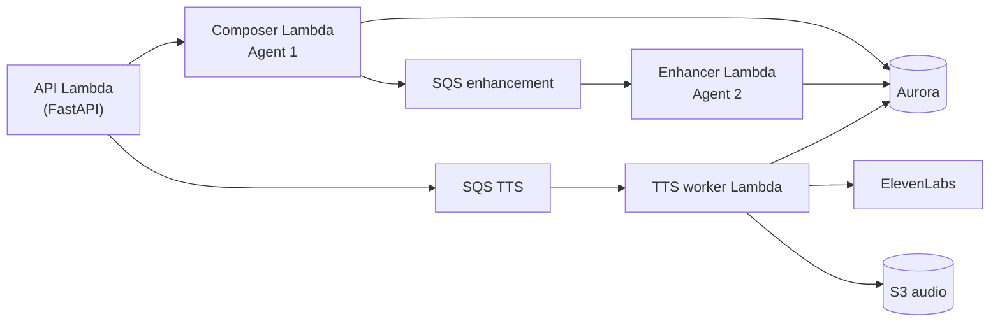

# Codebase overview
_Exported on 10/21/2026 at 19:35:49 GMT+5:30 from Cursor (3.12.30)_

---

**User**

read the whole codebase

---

**Cursor**

Surveying the repository structure and key modules to produce a coherent overview.


## What this repo is

**Creative Agent** is a monorepo for in-house meditation narration production: compose a script from a pattern library, enhance it for ElevenLabs TTS, then orchestrate audio generation, mixing, and manifests on AWS (Aurora, SQS, Lambda, S3).

Authoritative docs live under `guide/` — especially [`guide/architecture-and-tts-plane.md`](guide/architecture-and-tts-plane.md) and [`guide/tts-plane-phase-map.md`](guide/tts-plane-phase-map.md).

---

## End-to-end flow



**Transcript plane (stable):** brief → `RAW_PATTERN` → `PENDING_ENHANCEMENT` → SQS → `ELEVENLABS_ENHANCED` → `ENHANCED` (and `APPROVED` where used).

**TTS plane:** `ELEVENLABS_ENHANCED` → audio job → pause planning → chunk plan → sequential synthesis → stitch/finalize → background mix → manifest in S3 + metadata in Aurora.

---

## Package map (~150 application Python modules, excluding `.venv` and build artifacts)

| Area | Role |
|------|------|
| **`api/`** | FastAPI via Mangum: transcript CRUD/status, `POST /audio-jobs`, library routes, HTML dashboards (`dashboard.html`, `production.html`, `library.html`), API key auth |
| **`transcript_composer/`** | Agent 1: pattern knowledge (`data/*.md`), LLM script generation, validation (rules + optional LLM validator), theme/title/duration, persist + SQS publish |
| **`tts_enhancer/`** | Agent 2: Script Doctor engine, rewrite pipeline (beats, chunking, normalize), output modes (`plain_paste`, `api_chunked`, `v3_tagged`), SQS consumer |
| **`tts_pipeline/`** | TTS plane: intake, voice/background policy, **pause_planner** (OpenAI-assisted), chunk_planner, ElevenLabs generator, orchestrator workflow, finalizer (stitch, silence, mix, manifest), S3 persistence |
| **`db/`** | SQLAlchemy ORM, Alembic migrations (`001` transcript, `002` TTS audio, `003` approved status), repositories |
| **`queues/`** | Enhancement + TTS SQS publish/consume, idempotency helpers |
| **`models/`** | Shared enums, requests/responses, duration budget, metadata DTOs |
| **`observability/`** | Structured logging; TTS CloudWatch EMF metrics |
| **`pipeline_orchestrator/`** | Optional LangGraph CLI to drive API end-to-end with checkpoints (extra dep `[orchestrator]`) |
| **`infra/`** | Terraform: Lambdas, API Gateway, SQS, S3 TTS bucket, IAM, CloudWatch/alarms, Step Functions ASL (optional future) |
| **`tests/`** | Broad unit coverage + large `tests/tts/` suite (~60+ TTS tests) |
| **`scripts/`** | Lambda packaging, smoke tests, batch production helpers, background upload |

**Lambda entrypoints:** `transcript_composer/handler.py`, `tts_enhancer/handler.py`, `api/handler.py`, `tts_pipeline/handler.py`.

---

## Data model (high level)

- **Transcript:** `transcript`, `transcript_version` (kinds include `RAW_PATTERN`, `ELEVENLABS_ENHANCED`, etc.), `transcript_job_event`.
- **Audio:** `transcript_audio_job`, `transcript_audio_chunk`, `transcript_audio_asset`, `transcript_audio_event`.
- **Status enums** in `models/enums.py` — transcript lifecycle through `ENHANCED` / `APPROVED`; audio jobs through `PLANNING` → `GENERATING` → `COMPLETED` / `PARTIALLY_FAILED` / `REVIEW_REQUIRED`.

TTS workflow states (in-process orchestrator, not only Step Functions) include pause planning and background mix:

```12:27:d:\GenMyo Main\Creative Agent\tts_pipeline\orchestrator\workflow.py
class WorkflowState(StrEnum):
    VALIDATE_INPUT = "ValidateInput"
    CREATE_AUDIO_JOB = "CreateAudioJob"
    LOAD_ENHANCED_TRANSCRIPT = "LoadEnhancedTranscript"
    PLAN_PAUSES = "PlanPauses"
    PLAN_CHUNKS = "PlanChunks"
    MAP_PAUSES_TO_CHUNKS = "MapPausesToChunks"
    ...
    MIX_BACKGROUND = "MixBackground"
    FINALIZE_MANIFEST = "FinalizeManifest"
    MARK_COMPLETED = "MarkCompleted"
```

---

## Build / maturity (from guides + code)

- **Transcript plane:** treated as complete (Phases 0–10 in transcript phase map).
- **TTS plane:** Phases **0–12** marked complete in code (intake through observability); extensions beyond the original map include **pause planner** and **background_policy** / mixing.
- **Open work** (per `tts-plane-phase-map.md`): **Phase 13** security (Secrets Manager for ElevenLabs key, endpoint hardening, log redaction, retention); **Phase 14–15** full staging E2E integration tests and rollout verification (chunks/manifest/cost in prod-like env).

The `.cursor/rules` note about “next: Phase 5 voice policy” is **stale** relative to the phase map — voice policy, intake, chunking, generation, and finalization are already implemented.

---

## Repo noise (not “product code”)

Thousands of files under **`.venv/`**, **`infra/terraform/terraform.tfstate*`**, **`output/`**, **`.tmp_transcripts/`**, **`cred.txt`**, **`.env`** — dependencies, secrets, and local runs. First-party source is the packages listed in `pyproject.toml` setuptools `include`.

---

## Other notable areas

- **`guide/`** — architecture, agent specs, production plans (e.g. first-10 thin-wound), relatability prompt doc you had open.
- **`transcript_composer/data/`** — pattern index and examples driving Agent 1.
- **Stack:** Python 3.12, FastAPI, SQLAlchemy 2, Alembic, boto3, OpenAI (composer + pause planner), ElevenLabs (generator).

---

I’ve surveyed structure, handlers, data model, workflow, infra, and docs across the first-party tree. If you want to go deeper next, say which slice matters (e.g. pause planner, API routes, or composer validation) and we can walk it file-by-file.

---

**User**

you see there is an approval system

---

**Cursor**

Tracing how the approval system is implemented across the codebase.


Yes. There is a **human approval gate** between Agent 2 and TTS, centered on the **Script Hub** dashboard and an `APPROVED` / `APPROVED_FINAL` version lane.

## Where it lives

| Piece | Role |
|--------|------|
| **`/dashboard` (Script Hub)** | UI to list scripts, edit enhanced text, tweak pause markers and background bed, then approve |
| **`POST /transcripts/{id}/approve`** | Server-side approval + optional TTS enqueue |
| **`POST /transcripts/clear-pending-review`** | Bulk “dismiss” from the queue |
| **DB** | Status `ENHANCED` → `APPROVED`; new version kind `APPROVED_FINAL` (migration `003`) |

The hub defaults to filtering **`ENHANCED`** as “Pending Review”. After approval, status becomes **`APPROVED`** and the approve button is disabled.

## Lifecycle

1. **Agent 2** finishes → transcript **`ENHANCED`**, version **`ELEVENLABS_ENHANCED`**.
2. **Reviewer** opens Script Hub, sees `pause_review_text` (beats + draft/human pauses) and can pick a background profile.
3. **Approve** calls `TranscriptApiService.approve_transcript`, which:
   - Parses human markers like `[pause 2s]` into a **`human_pause_plan`** on version metadata (or clears them so TTS uses the auto OpenAI pause planner).
   - Syncs **`content_json.beats`** to the edited speech units.
   - Creates or **updates** an **`APPROVED_FINAL`** row (`created_by_agent="reviewer"`, sourced from the enhanced version).
   - Sets **`current_version_id`** to that row and status **`APPROVED`**.
   - Records **`TRANSCRIPT_APPROVED`** on `transcript_job_event`.
4. By default it **creates an audio job** on the **`APPROVED_FINAL`** version and enqueues the TTS worker (voice profile default). If enqueue fails, approval still commits; the API returns **`tts_enqueue_error`**.

TTS intake explicitly allows **`ENHANCED` or `APPROVED`** transcripts and **`ELEVENLABS_ENHANCED` or `APPROVED_FINAL`** versions — but the approve path is designed so production runs off **`APPROVED_FINAL`** with reviewer locks on pauses and bed.

## Queue management (not quite “reject”)

**`clear_pending_review`** moves every tenant **`ENHANCED`** transcript to **`REVIEW_REQUIRED`** with a “cleared from Script Hub” reason — they leave the pending queue without being approved.

State rules in `db/state.py`: from **`ENHANCED`** you can go to **`APPROVED`** or **`REVIEW_REQUIRED`**; **`APPROVED`** can only go back to **`REVIEW_REQUIRED`** (re-open review, not auto re-enhance from that transition alone).

## Separate from transcript approval

- **`tts_pipeline/voice_policy`** and **`background_policy`** use “approved” **profiles** (catalog allowlists), not the human script gate.
- **Audio jobs** can hit **`REVIEW_REQUIRED`** on TTS failures (orchestrator escalation) — that’s downstream ops review, not Script Hub script approval.

So the product model matches your relatability doc line: enhanced script → **human (Script Hub) approve** → **`APPROVED_FINAL`** → TTS with reviewer-controlled pauses and background where set.

If you want to go deeper on one path (e.g. re-approve behavior, or starting TTS without approve via `POST /audio-jobs`), say which.

---

**User**

but what if we dont want approval thing 

the human that used to approve was he used to see that if the transcript is relatable with the knowledge if it is then it was approved 

i need to remove human in the loop

---

**Cursor**

Exploring how approval gates TTS and what relatability checks exist so we can design removing human-in-the-loop.


You're right about **why** the human was there — Script Hub was acting as a **relatability QA gate** (“does this feel written for this wound/gen/situation?”), not just a mechanical approve button. In code, though, approval does **more** than that check, and the relatability knowledge is **not** what the button runs today.

## What approval actually does in code

When someone clicks **Approve & Send to TTS**, the system:

1. Parses optional human pause markers (`[pause 2s]`) into `human_pause_plan` on **`APPROVED_FINAL`**
2. Locks background bed choice (reviewer override or cached OpenAI pick)
3. Sets status **`APPROVED`** and enqueues TTS on **`APPROVED_FINAL`**

There is **no** automated “compare transcript to `first10_relatability_pack`” step on approve. The reviewer’s judgment was manual; the pack lives in [`guide/first10_relatability_pack.md`](guide/first10_relatability_pack.md) and is **not** loaded by validators yet (your Claude prompt even says “wire into Agent 1 + validators” — still pending).

So removing the human means **two** separate decisions:

| Concern | Today | Without human |
|--------|--------|----------------|
| **Relatability** | Human reads script vs knowledge | **Automated validator** (pack + LLM or rules) on Agent 1 and/or post–Agent 2 |
| **Gate before TTS** | Script Hub → approve → TTS | **Auto-continue** after `ENHANCED` (or after auto-QA pass) |
| **Pauses / bed** | Human edits in hub | **Auto**: density/OpenAI pause planner + background policy (already in TTS plane) |

## You can already skip Script Hub for TTS (partially)

TTS intake accepts **`ENHANCED`** + **`ELEVENLABS_ENHANCED`** — you don’t *have* to create `APPROVED_FINAL` to render audio.

[`scripts/run_full_pipeline.ps1`](scripts/run_full_pipeline.ps1) already waits for **`ENHANCED`**, picks enhanced (or approved if present), and **`POST /audio-jobs`** — no approve step.

What **still** assumes humans:

- **Batch samples** ([`scripts/create_batch_cd_samples.py`](scripts/create_batch_cd_samples.py)) stop at enhance → “ready for approval”
- **Script Hub** default queue = `ENHANCED` pending review
- **LangGraph orchestrator** treats enhance success as **`APPROVED`**, not **`ENHANCED`** (`pipeline_orchestrator/state.py`), so that path **blocks** until someone approves unless you change it

## Recommended shape: replace human relatability, not delete QA

The doc pipeline you want is already spelled out as “human **or auto** approve → `APPROVED_FINAL`”. The **auto** branch should be:

```text
Agent 2 → ENHANCED
  → relatability validator (pack: scene anchors, gen markers, “would this pass as CODE-X?” tests)
      pass → enqueue TTS (ELEVENLABS_ENHANCED or lightweight auto-promote to APPROVED_FINAL with no text edits)
      fail → REVIEW_REQUIRED (+ optional Agent 1/2 retry), same as enhancement quality failures
```

**Where to enforce relatability**

- **Agent 1** (extend rules + [`transcript_composer/validation/llm_validator.py`](transcript_composer/validation/llm_validator.py)): catch generic meditation before enhance (cheaper).
- **Post–Agent 2** (new check): ensure Script Doctor didn’t **wash** wound-specific anchors (your pack’s before/after examples) — that’s the failure mode humans were catching.

**What you can turn off**

- Script Hub as a **required** step (keep as optional ops UI if you want).
- `APPROVED` / `APPROVED_FINAL` as a **hard** gate — optional if TTS always runs on enhanced text and auto pause/bed policies are good enough.

## What I would **not** do

- Remove approval **without** adding the automated relatability gate — you’d just move “bad generic scripts” into TTS faster.
- Assume Agent 1’s current validator is enough — it checks pattern index / tone, **not** the First-10 relatability tests in the pack.

---

If you want this implemented in the repo, a sensible **Phase 1** is:

1. Env flag e.g. `CREATIVE_AGENT_AUTO_CONTINUE_TTS=true` → after Agent 2 success, enqueue TTS (reuse `_enqueue_tts_after_approve` logic but on `ELEVENLABS_ENHANCED`, no hub).
2. Fix orchestrator `ENHANCE_SUCCESS_STATUS` → `ENHANCED` when auto mode is on.
3. Relatability validator module fed from structured JSON derived from the pack; run post–Agent 2; on fail → `REVIEW_REQUIRED`.

Say whether you want **auto-TTS only first** (fast path, accept current Agent 1/2 quality) or **validator + auto-TTS together** (safer replacement for the human). I can implement either in the codebase next.

