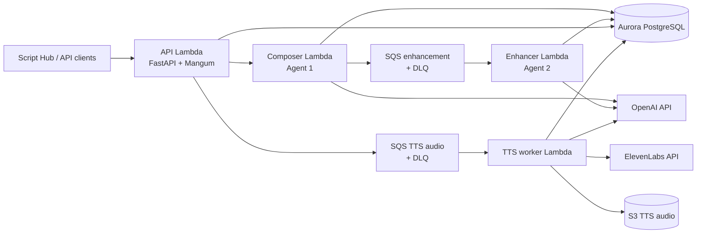

# Creative Agent — Ultra-Detailed Project Reference

> **Purpose:** Single deep-dive document covering product intent, architecture, code layout, data model, APIs, agents, TTS orchestration, approval, infra, env, tests, and maturity.  
> **Audience:** Engineers, operators, and agents working in this monorepo.  
> **Authority chain:** This file summarizes *as implemented*. For phase checklists and historical build decisions, also see the linked guides below. When implementation and an older guide disagree, **prefer the code**.

| Related doc | Role |
|-------------|------|
| [`architecture-and-tts-plane.md`](architecture-and-tts-plane.md) | Master architecture + TTS plane design |
| [`AGENTS.md`](AGENTS.md) | Transcript agents, invariants, contracts |
| [`DetailedBreakdown.md`](DetailedBreakdown.md) | Full transcript specification |
| [`Agent2-guide.md`](Agent2-guide.md) | Script Doctor rewrite rules (prompt source) |
| [`transcript-enhancement-phase-map.md`](transcript-enhancement-phase-map.md) | Transcript build checklist (complete) |
| [`tts-plane-phase-map.md`](tts-plane-phase-map.md) | TTS build checklist |
| [`meditation-pause-planning.md`](meditation-pause-planning.md) / [`meditation-pause-planning-phase-map.md`](meditation-pause-planning-phase-map.md) | Pause planner design |
| [`background-audio-mixing.md`](background-audio-mixing.md) / [`background-audio-mixing-phase-map.md`](background-audio-mixing-phase-map.md) | Background mix design |
| [`first10_relatability_pack.md`](first10_relatability_pack.md) | First-10 thin-wound relatability knowledge |
| [`first-10-thin-wound-production-plan.md`](first-10-thin-wound-production-plan.md) | Production ops plan |
| [`infra/README.md`](../infra/README.md) | Terraform deploy / smoke |

**Last surveyed against codebase:** 2026-10-21.

---

## Table of contents

1. [Executive summary](#1-executive-summary)
2. [Product goals and non-goals](#2-product-goals-and-non-goals)
3. [High-level architecture](#3-high-level-architecture)
4. [Core invariants](#4-core-invariants)
5. [Repository layout](#5-repository-layout)
6. [Technology stack](#6-technology-stack)
7. [End-to-end lifecycle](#7-end-to-end-lifecycle)
8. [Domain model and taxonomy](#8-domain-model-and-taxonomy)
9. [Data model (Aurora)](#9-data-model-aurora)
10. [Status machines](#10-status-machines)
11. [Agent 1 — Pattern Transcript Composer](#11-agent-1--pattern-transcript-composer)
12. [Agent 2 — ElevenLabs Script Doctor](#12-agent-2--elevenlabs-script-doctor)
13. [Relatability and quality gates](#13-relatability-and-quality-gates)
14. [Human approval (Script Hub)](#14-human-approval-script-hub)
15. [TTS Orchestration Plane](#15-tts-orchestration-plane)
16. [Voice and background policy](#16-voice-and-background-policy)
17. [Pause planning](#17-pause-planning)
18. [Chunk planning and generation](#18-chunk-planning-and-generation)
19. [Finalizer (stitch, silence, mix, manifest)](#19-finalizer-stitch-silence-mix-manifest)
20. [Queues and message contracts](#20-queues-and-message-contracts)
21. [Intake API](#21-intake-api)
22. [Pipeline orchestrator (LangGraph)](#22-pipeline-orchestrator-langgraph)
23. [Persistence and S3](#23-persistence-and-s3)
24. [Observability](#24-observability)
25. [AWS infrastructure](#25-aws-infrastructure)
26. [Configuration and secrets](#26-configuration-and-secrets)
27. [Local development](#27-local-development)
28. [Testing](#28-testing)
29. [Scripts and operators](#29-scripts-and-operators)
30. [Security model](#30-security-model)
31. [Maturity, gaps, and known doc drift](#31-maturity-gaps-and-known-doc-drift)
32. [Glossary](#32-glossary)

---

## 1. Executive summary

**Creative Agent** is an in-house, production-facing monorepo for **meditation narration production**. It turns a taxonomy brief (generation, wound, stage, pillar, duration) into:

1. A **raw pattern transcript** (therapeutic structure + tone),
2. An **ElevenLabs-optimized enhanced script**,
3. Optionally a **human-approved final** (Script Hub),
4. **Spoken audio** (chunked ElevenLabs synthesis),
5. A **stitched final** with meditation **silence holds**,
6. A **master mix** with a catalog background bed,
7. A **JSON manifest** and Aurora metadata for ops / library.

The system is split into two **planes**:

| Plane | Code | Responsibility |
|-------|------|----------------|
| **Transcript plane** | `api/`, `transcript_composer/`, `tts_enhancer/`, `db/`, `queues/` | Compose + enhance text; immutable versioned storage |
| **TTS plane** | `tts_pipeline/` | Audio jobs, pauses, chunks, ElevenLabs, S3, mix, manifest |

Planes share Aurora and tenant context. They must **not** be collapsed into one Lambda or one rewrite step. Content correctness and speakability are different failure domains from audio generation and asset persistence.

**Runtime shape (AWS):**

- FastAPI on Lambda (`api`) behind API Gateway  
- Composer Lambda (`transcript_composer`)  
- Enhancer Lambda (`tts_enhancer`) triggered by SQS  
- TTS worker Lambda (`tts_pipeline`) triggered by SQS  
- Aurora PostgreSQL (system of record)  
- S3 bucket for audio binaries  
- Secrets Manager for DB / OpenAI / ElevenLabs / API key  

---

## 2. Product goals and non-goals

### Goals

- Produce **wound- and generation-specific** guided meditation scripts (not generic calm-down copy).
- Keep scripts **speakable** for ElevenLabs (prosody, punctuation, chunking, pronunciation notes).
- Store every meaningful text revision as an **immutable version**.
- Generate **production audio** with controlled voice/settings and background beds.
- Support **idempotent retries** (SQS duplicates, partial chunk regen, orchestrator replay).
- Give operators **Script Hub**, **production checklist**, and **listen library** UIs.

### Non-goals (out of scope for this system)

- Video rendering / visual scene planning  
- Subtitle timecoding as a product deliverable  
- Public consumer app / publishing marketplace  
- Arbitrary caller-driven ElevenLabs voice config (policy layer only)  
- Rewriting therapeutic meaning inside the TTS plane  
- Voice cloning pipelines as a first-class feature  

---

## 3. High-level architecture

### 3.1 Logical flow



### 3.2 Why two agents + a separate TTS plane

| Concern | Owner | Failure mode if mixed |
|---------|-------|------------------------|
| Therapeutic fit / pattern structure | Agent 1 | Speakability hacks corrupt wound language |
| TTS speakability | Agent 2 | Content rewrites hide under “polish” |
| Audio / continuity / cost / S3 | TTS plane | Retrying audio re-runs expensive LLM compose |

### 3.3 Orchestration reality vs original Step Functions recommendation

The architecture guide **recommends** AWS Step Functions for TTS. **As implemented**, the TTS worker Lambda runs an **in-process workflow engine** (`tts_pipeline/orchestrator/`) driven by SQS messages (same pattern as Agent 2). Step Functions ASL may exist as optional future infra; production path today is **SQS → TTS Lambda → `TtsWorkflowEngine`**.

---

## 4. Core invariants

These are non-negotiable. Violating them breaks trust in lineage, retries, or cost control.

### Transcript plane

1. **Agent 2 reads from DB only** — never synthesize from an unstored in-memory transcript or from large SQS payloads.
2. **Never overwrite raw transcript text** — always append a new `transcript_version` row.
3. **SQS for Agent 1 → Agent 2 handoff** — not DB polling as the default trigger.
4. **Separate Lambda handlers** for compose and enhance.
5. **Transactional status changes** before / with side effects that depend on status.
6. **Lambda 2 must be idempotent** (SQS at-least-once delivery).
7. **Queue messages are identifiers only** — no large text blobs.
8. **Agent 2 preserves Agent 1’s emotional register and therapeutic intent** — speakability, not reinterpretation.

### TTS plane

9. **Do not rewrite script meaning** in TTS (pauses/silence/mix only; text is taken from the chosen version).
10. **Chunk generation is idempotent** — completed chunks are skipped unless explicit regen.
11. **Voice policy is allowlisted** — callers pick `voice_profile_code`, not raw unbounded `voice_id` / settings.
12. **Binary audio in S3; metadata in Aurora.**
13. **Continuity context** (`previous_text` / `next_text` / request IDs) preserved across sequential generation and middle-chunk regen.

### Approval / production

14. Production Script Hub path promotes **`APPROVED_FINAL`** and enqueues TTS; intake **also** allows `ENHANCED` + `ELEVENLABS_ENHANCED` for bypass / smoke paths.
15. Approve may succeed even if TTS enqueue fails — surface `tts_enqueue_error` rather than rolling back approval.

---

## 5. Repository layout

```text
Creative Agent/
├── api/                      # FastAPI intake + dashboards (Mangum Lambda)
│   ├── routes/               # transcripts, audio_jobs, library
│   ├── templates/            # dashboard.html, production.html, library.html
│   ├── transcript_service.py # status, approve, wait, background, clear-pending
│   ├── audio_service.py      # create job + enqueue TTS
│   ├── library_service.py
│   ├── production_state.py   # First-10 checklist persistence
│   ├── auth.py / dependencies.py / handler.py / main.py
├── transcript_composer/      # Agent 1
│   ├── data/                 # pattern index, examples, relatability JSON
│   ├── knowledge/            # loader, selector, example retriever
│   ├── validation/           # rules + LLM validator
│   ├── composition_service.py, script_generator.py, persistence.py, …
├── tts_enhancer/             # Agent 2
│   ├── rewrite/              # cleanup, normalize, beats, chunking, voice_notes
│   ├── formats/              # plain_paste, api_chunked, v3_tagged
│   ├── script_doctor.py, enhancement_service.py, engine.py, …
├── tts_pipeline/             # TTS plane
│   ├── intake/
│   ├── orchestrator/
│   ├── pause_planner/
│   ├── chunk_planner/
│   ├── generator/
│   ├── finalizer/
│   ├── voice_policy/
│   ├── background_policy/
│   ├── persistence/
│   ├── handler.py, consumer_service.py
├── pipeline_orchestrator/    # Optional LangGraph CLI (extra dep [orchestrator])
├── db/                       # SQLAlchemy ORM, Alembic, repositories, state
├── queues/                   # Enhancement + TTS publish/consume helpers
├── models/                   # Enums, DTOs, messages, errors
├── observability/            # Structured logging + TTS metrics
├── infra/terraform/          # AWS resources
├── scripts/                  # Packaging, smoke, batch production helpers
├── tests/                    # Unit + tests/tts/
├── guide/                    # Specs and this document
├── .cursor/rules/            # Cursor implementation context
├── pyproject.toml
└── .env.example
```

**Setuptools packages** (`pyproject.toml` include):  
`api*`, `transcript_composer*`, `tts_enhancer*`, `tts_pipeline*`, `pipeline_orchestrator*`, `db*`, `queues*`, `models*`, `observability*`.

**Not product code (noise):** `.venv/`, Terraform state, `output/`, `.tmp_transcripts/`, local `.env` / credential files.

### Lambda entrypoints

| Function | Handler |
|----------|---------|
| Composer | `transcript_composer.handler.handler` |
| Enhancer | `tts_enhancer.handler.handler` |
| API | `api.handler.handler` |
| TTS worker | `tts_pipeline.handler.handler` |

---

## 6. Technology stack

| Layer | Choice |
|-------|--------|
| Language | Python **3.12+** |
| API | FastAPI + Mangum |
| Validation / DTOs | Pydantic v2 |
| ORM | SQLAlchemy 2 |
| Migrations | Alembic (`db/alembic.ini`) |
| DB | Aurora PostgreSQL (local: Docker Postgres) |
| AWS SDK | boto3 |
| LLM (compose, validate, Script Doctor, pause planner, bed select) | OpenAI SDK |
| TTS | ElevenLabs Create speech HTTP API |
| Audio stitch / mix | ffmpeg (silence, concat, amix / duck) |
| Optional E2E CLI | LangGraph (`pip install -e ".[orchestrator]"`) |
| Infra | Terraform ≥ 1.5 |
| Lint / test | ruff, pytest |

---

## 7. End-to-end lifecycle

### 7.1 Happy path (production with Script Hub)

```text
1. Client POST /transcripts  (or invoke composer)
2. Agent 1 selects patterns → generates 6 sections → validates
3. Aurora: transcript CREATED → RAW_PATTERN version → PENDING_ENHANCEMENT
4. Commit, then publish EnhancementJobMessage to SQS
5. Agent 2 claims PENDING_ENHANCEMENT → ENHANCING
6. Script Doctor rewrite → ELEVENLABS_ENHANCED → status ENHANCED
7. Reviewer opens /dashboard (Script Hub), edits pauses/bed/text
8. POST /transcripts/{id}/approve
      → APPROVED_FINAL version + status APPROVED
      → create audio job on APPROVED_FINAL
      → publish TtsAudioJobMessage
9. TTS worker runs workflow:
      PlanPauses → PlanChunks → MapPauses → Generate → Stitch FINAL
      → Mix MASTER → Manifest → COMPLETED
10. Library / download via API + S3 keys / presigned URLs
```

### 7.2 Bypass path (no human approve)

```text
ENHANCED + ELEVENLABS_ENHANCED
  → POST /audio-jobs
  → same TTS worker workflow
  → OpenAI pause planner (no human_pause_plan)
  → background from enhanced metadata / default catalog
```

Used by smoke scripts such as `scripts/run_full_pipeline.ps1`.

### 7.3 Failure / review paths

| Stage | Typical outcome |
|-------|-----------------|
| Agent 1 validation fail | Compose retry (theme/relatability) or 422 to API |
| Agent 2 quality fail | `REVIEW_REQUIRED` |
| Agent 2 transient / claim race | SQS retry |
| Repeated enhance failures | DLQ + alarms |
| TTS permanent / quota / review escalation | audio job `REVIEW_REQUIRED` or `FAILED` / `PARTIALLY_FAILED` |
| Script Hub dismiss queue | `ENHANCED` → `REVIEW_REQUIRED` via clear-pending |

---

## 8. Domain model and taxonomy

Intake briefs are taxonomy-constrained (`models/validation.py` / `CreateTranscriptRequest`):

| Field | Meaning |
|-------|---------|
| `tenant_id` | Multi-tenant isolation key |
| `content_type` | Content class (e.g. guided meditation) |
| `generation_code` | Audience generation segment |
| `wound_id` | Wound / theme identifier in pattern index |
| `stage_no` | Stage number in product taxonomy |
| `pillar_code` | Optional pillar |
| `principles` | Optional principle tags |
| `target_duration_minutes` | Wall-clock target (speech + holds planned later) |
| `title_hint` | Often includes product codes like `WK-06` for relatability pack resolution |
| `requested_output_mode` | Agent 2 mode (`plain_paste` / `api_chunked` / `v3_tagged`) |
| `voice_model` | Hint for enhancement formatting / voice model string |

**Six script sections (Agent 1):**  
`opening` → `settling` → `body` → `breath` → `mind_heart` → `closing`

**Duration budgeting:** speech estimate (WPM) is separate from wall-clock target; silence holds are planned in the TTS plane to fill listening time without stuffing empty words into the script.

---

## 9. Data model (Aurora)

Migrations:

| Revision | Purpose |
|----------|---------|
| `001_initial_schema` | Transcript, version, job_event (+ version kinds incl. `APPROVED_FINAL`) |
| `002_tts_audio_schema` | Audio job / chunk / asset / event |
| `003_add_approved_status` | Adds `APPROVED` to transcript status CHECK |

ORM: `db/orm.py`. Repositories: `db/repositories/transcript_repository.py`, `audio_job_repository.py`. Sessions: `db/session.py` (`session_scope` with retry on serialization/deadlock).

### 9.1 `transcript`

Entity row for one narration job.

| Column | Notes |
|--------|-------|
| `id` | UUID PK |
| `tenant_id` | Required |
| `asset_id` | Optional upstream asset link |
| `content_type`, `generation_code`, `wound_id`, `stage_no`, `pillar_code` | Taxonomy |
| `status` | See status machine |
| `current_version_id` | FK → `transcript_version` (points at “current” text) |
| `enhancement_attempt_count` | Incremented on claim |
| `last_error` | Last failure note |
| `created_at`, `updated_at` | Timestamps |

### 9.2 `transcript_version`

Immutable content versions.

| Column | Notes |
|--------|-------|
| `version_kind` | `RAW_PATTERN`, `ELEVENLABS_ENHANCED`, `ELEVENLABS_TAGGED`, `APPROVED_FINAL` |
| `content_text` | Full spoken / script text |
| `content_json` | Structured payload (sections, beats, formatters, etc.) |
| `created_by_agent` | e.g. composer agent id, `script_doctor`, `reviewer` |
| `metadata_json` | Duration, pattern plan, `human_pause_plan`, background selection, … |
| `source_version_id` | Lineage (enhanced←raw, approved←enhanced) |
| `enhancement_mode` | Uniqueness key with source for enhanced/approved rows |

**Never update `content_text` in place for lineage.** Exception: re-approve **replaces** the existing `APPROVED_FINAL` row for the same source+mode (reviewer iteration), which is intentional.

### 9.3 `transcript_job_event`

Append-only audit (`event_type` + `event_payload`), e.g. `TRANSCRIPT_QUEUED`, `ENHANCEMENT_COMPLETED`, `TRANSCRIPT_APPROVED`.

### 9.4 `transcript_audio_job`

One TTS generation run bound to a specific transcript version.

Key fields: `idempotency_key`, voice/model/format, status counters, `seed`, `enable_logging`, `apply_text_normalization`, `estimated_duration_ms`, `final_asset_id`, `metadata_json` (pause plans, background, etc.), `retry_count`, `failure_notes`.

### 9.5 `transcript_audio_chunk`

One synthesis unit: `chunk_index`, `source_text`, continuity fields, ElevenLabs request id, S3 object key, durations, errors, retry count.

Unique: `(audio_job_id, chunk_index)`.

### 9.6 `transcript_audio_asset`

Stored artifact pointer: `asset_kind` ∈ `chunk` | `final` | `master` | `manifest` | `debug`, plus `object_key`, mime, checksum, byte size.

### 9.7 `transcript_audio_event`

Audio-job audit trail.

---

## 10. Status machines

### 10.1 Transcript statuses (`models/enums.py` + `db/state.py`)

```text
CREATED
  → PENDING_ENHANCEMENT
      → ENHANCING
          → ENHANCED
          → FAILED_ENHANCEMENT
          → REVIEW_REQUIRED
      → FAILED_ENHANCEMENT

ENHANCED → APPROVED | REVIEW_REQUIRED
FAILED_ENHANCEMENT → PENDING_ENHANCEMENT | REVIEW_REQUIRED
REVIEW_REQUIRED → PENDING_ENHANCEMENT | ENHANCED | APPROVED
APPROVED → REVIEW_REQUIRED   (re-open only; not auto re-enhance)
```

Enforced by `assert_transition_allowed`.

### 10.2 Version kinds

| Kind | Producer |
|------|----------|
| `RAW_PATTERN` | Agent 1 |
| `ELEVENLABS_ENHANCED` | Agent 2 |
| `ELEVENLABS_TAGGED` | Reserved / tagged mode |
| `APPROVED_FINAL` | Script Hub reviewer (`created_by_agent="reviewer"`) |

### 10.3 Audio job statuses

`CREATED` → `PLANNING` → `READY` → `GENERATING` → (`PARTIALLY_FAILED`) → `COMPLETED` | `FAILED` | `REVIEW_REQUIRED`

### 10.4 Audio chunk statuses

`PLANNED` | `GENERATING` | `COMPLETED` | `FAILED` | `RETRYING` | `SKIPPED`

### 10.5 In-process TTS workflow states

```text
ValidateInput
CreateAudioJob
LoadEnhancedTranscript
PlanPauses
PlanChunks
MapPausesToChunks
PersistChunkPlan
GenerateChunksSequentially
RegisterAssets
FinalizeFinal
MixBackground
FinalizeManifest
MarkCompleted
FailureHandler
Succeeded
```

Defined in `tts_pipeline/orchestrator/workflow.py`. Per-state retry/timeout policy in `orchestrator/config.py`.

---

## 11. Agent 1 — Pattern Transcript Composer

**Package:** `transcript_composer/`  
**Entry:** `handler.py` → `Agent1Service.run` (`service.py`)

### 11.1 Responsibilities

- Validate intake brief / taxonomy  
- Select a **pattern plan** across six slots from the pattern index  
- Retrieve nearest **examples** for tone (style reference, not copy source)  
- Generate sectioned narration (OpenAI or template fallback)  
- Build title + duration estimate + session duration budget metadata  
- Validate (rules and/or LLM)  
- Persist `RAW_PATTERN` and set `PENDING_ENHANCEMENT`  
- Publish enhancement SQS message  

### 11.2 Knowledge sources

| Asset | Path | Role |
|-------|------|------|
| Pattern index | `transcript_composer/data/meditation_patterns_index.md` | Structural blueprint / pattern families |
| Examples | `transcript_composer/data/meditation_patterns_examples.md` | Tone / register corpus |
| Relatability pack | `transcript_composer/data/first10_relatability_pack.json` | First-10 product codes + validator seeds |

Loaders / selectors: `knowledge/loader.py`, `pattern_selector.py`, `example_retriever.py`.

### 11.3 Composition pipeline (`composition_service.py`)

1. `PatternSelector.build_pattern_plan`  
2. `ExampleRetriever` ranks examples  
3. `ScriptGenerator` writes six sections (injects theme + relatability prompt blocks when pack matches)  
4. `build_title` / `estimate_duration_seconds` / duration budget helpers  
5. `TranscriptValidator.validate_or_raise`  

`Agent1Service` may **retry compose up to 2 attempts** when validation fails on theme/relatability error codes.

### 11.4 Generators and modes

Env: `CREATIVE_AGENT_SCRIPT_GENERATOR` = `auto` | `openai` | `template`

- **openai:** production path; OpenAI section generation  
- **template:** offline / no-key path; forces rules-mode validation tendencies  
- **auto:** prefer OpenAI when key present  

Model: `CREATIVE_AGENT_OPENAI_MODEL` (default `gpt-4o-mini` in `.env.example`).

### 11.5 Persistence sequence

1. Insert transcript (`CREATED`) if needed  
2. Insert `RAW_PATTERN` version  
3. Status → `PENDING_ENHANCEMENT` + event `TRANSCRIPT_QUEUED`  
4. **Commit**  
5. Publish `EnhancementJobMessage`  

If publish fails after commit, the transcript remains queued in DB for operator retry / replay patterns.

### 11.6 Validation overview

Orchestrator: `validation/transcript_validator.py`

| Mode (`CREATIVE_AGENT_TRANSCRIPT_VALIDATOR`) | Behavior |
|---------------------------------------------|----------|
| `openai` | Hard deterministic set (structure, theme, relatability, leakage, verbatim, …) + LLM qualitative review (LLM issues often downgraded to warnings) |
| `rules` | Deterministic structure/plan/taxonomy/duration/hygiene/invite/beats/verbatim — **does not** run session theme / relatability pack checks |
| `auto` | OpenAI when key set, else rules |

See [§13](#13-relatability-and-quality-gates) for relatability details.

---

## 12. Agent 2 — ElevenLabs Script Doctor

**Package:** `tts_enhancer/`  
**Entry:** SQS Lambda `handler.py` → `EnhancementConsumerService` → `EnhancementService`

### 12.1 Responsibilities

- Validate handoff message + tenant + raw version exists  
- Skip if enhanced version already exists (idempotency)  
- Atomic claim: `PENDING_ENHANCEMENT` → `ENHANCING`  
- Load **raw text from Aurora**  
- Rewrite via Script Doctor (OpenAI guided by `guide/Agent2-guide.md`, or deterministic polish)  
- Build beats, voice notes, mode-specific `content_json`  
- Insert `ELEVENLABS_ENHANCED`, set `current_version_id`, status `ENHANCED`  

### 12.2 Output modes (`EnhancementMode`)

| Mode | Use |
|------|-----|
| `plain_paste` | Clean paragraphs/beats for manual ElevenLabs UI |
| `api_chunked` | Chunked output with continuity fields for API |
| `v3_tagged` | Chunked + sparse v3 audio tags |

Uniqueness for enhanced versions: `(source_version_id, enhancement_mode)`.

### 12.3 Rewrite pipeline (order)

1. Structural cleanup (`rewrite/cleanup.py`)  
2. Ear-first rewrite (Script Doctor)  
3. Punctuation / token normalize (`rewrite/normalize.py`)  
4. Beats (`rewrite/beats.py`)  
5. Chunking helpers (`rewrite/chunking.py`)  
6. Voice / pronunciation notes  
7. Formatters under `formats/`  

Env: `CREATIVE_AGENT_SCRIPT_DOCTOR` = `auto` | `openai` | `deterministic`.

### 12.4 Quality gate (thin)

`quality.py` / `validate_enhanced_output`:

- Non-empty output  
- If raw ≥ 20 words, enhanced must be ≥ ~50% of raw word count  

Quality failure → `REVIEW_REQUIRED`.  
**No relatability re-check after rewrite** — this is a known gap if humans are removed from the loop.

### 12.5 Idempotency mechanisms

- Message `idempotency_key` = `{transcript_id}:{raw_version_id}:enhancement-v1`  
- Early skip when enhanced already present or status already `ENHANCED`  
- DB unique constraint on enhancement pair  
- Concurrent claim → transient error → SQS retry  
- Partial batch failure reporting (`batchItemFailures`)  

---

## 13. Relatability and quality gates

### 13.1 Why relatability exists

First-10 thin-wound products must feel written for a specific **wound / generation / situation**, not generic meditation. Human Script Hub reviewers historically acted as a **relatability QA gate**. The pack encodes that knowledge for prompts and validators.

### 13.2 Pack location and resolution

- JSON: `transcript_composer/data/first10_relatability_pack.json`  
- Markdown guide: `guide/first10_relatability_pack.md`  
- Code: `transcript_composer/relatability.py`  

Resolution order:

1. Product code in `title_hint` (regex for `WK-##`, `PH-##`, `BO-##`, `GX-##`, `GZ-##`, `ML-##`, `FR`)  
2. Else `wound_id` mapped via preferred / fallback proxy wound IDs  

Example codes: WK-06, BO-04, GX-01, GZ-04, ML-03, PH-01, WK-04, WK-05, PH-03, FR.

### 13.3 What is enforced in code today

When pack entry resolves and validator mode includes relatability (openai hard path):

| Check | Severity |
|-------|----------|
| Forbidden patterns (product codes in body, “you must”, upskill language, …) | error |
| Required keyword groups (scene anchors) | error |
| Opening theme hit count | error |
| Pillar cue groups | error |
| Generation cue groups | warn |

Prompt injection: `format_relatability_block` into Agent 1 section generation.

### 13.4 What is **not** fully automated yet

| Item | Status |
|------|--------|
| `fail_if_better_matches` | In pack/guide; **not coded** |
| Must-use phrases as hard required hits | Prompted; not fully enforced as required list |
| Full semantic fidelity to brief portrait / closing promise | Prompt-level only |
| Post–Agent 2 relatability | **Missing** — Script Doctor can wash anchors |
| Rules/template validation mode | Skips relatability/theme hard checks |

### 13.5 Human vs machine today

- **Human:** Script Hub approve (judgment + pause/bed edits)  
- **Machine:** Agent 1 pack checks (when openai validator path)  
- **Approve button does not load the relatability pack** — it parses pauses, locks bed, promotes version, enqueues TTS  

---

## 14. Human approval (Script Hub)

### 14.1 UI surfaces (`api/main.py`)

| Route | UI |
|-------|----|
| `GET /dashboard` | **Script Hub** — pending `ENHANCED` queue, editor, approve |
| `GET /dashboard/production` | First-10 production checklist |
| `GET /dashboard/library` | Completed masters browse |
| `GET/PUT /dashboard/production/state` | Checklist JSON persistence |

Auth: most JSON APIs require `X-API-Key` + `X-Tenant-Id`. Dashboard HTML is served by the API Lambda; API calls from the page use the same key headers.

### 14.2 Approve API

`POST /transcripts/{id}/approve`  
Body: `ApproveTranscriptRequest` (`approved_text`, `background_profile_code`, `correlation_id`)

Implementation: `TranscriptApiService.approve_transcript` in `api/transcript_service.py`.

**Steps:**

1. Require `ELEVENLABS_ENHANCED` version exists.  
2. Parse `approved_text` (or enhanced text) for human markers `[pause]` / `[pause Ns]` → spoken text + `human_pause_plan`.  
3. Sync `content_json.beats` to speech units between markers.  
4. Insert or **replace** `APPROVED_FINAL` (`created_by_agent="reviewer"`).  
5. Copy / lock background selection (reviewer override or prior OpenAI pick).  
6. Status → `APPROVED`; `current_version_id` → approved version.  
7. Event `TRANSCRIPT_APPROVED`.  
8. Unless disabled, create audio job with default voice profile and enqueue TTS.  
9. On enqueue failure: return status with `tts_enqueue_error` (approval already committed).

Empty markers → no `human_pause_plan` → TTS uses OpenAI pause planner.

### 14.3 Clear pending review

`POST /transcripts/clear-pending-review`  
Bulk: all tenant `ENHANCED` → `REVIEW_REQUIRED` (“cleared from Script Hub”). Not a semantic reject with feedback; removes from pending queue.

### 14.4 Background override without full approve

`PUT /transcripts/{id}/background` — reviewer bed choice on enhanced / approved metadata.

### 14.5 Role of approval vs TTS intake

| | Script Hub path | Bypass path |
|--|-----------------|-------------|
| Transcript status | `APPROVED` | `ENHANCED` |
| Version | `APPROVED_FINAL` | `ELEVENLABS_ENHANCED` |
| Pauses | Human plan preferred | Auto OpenAI + density |
| Bed | Locked selection | Metadata / default |

TTS intake allowlists both (see §15.2).

---

## 15. TTS Orchestration Plane

**Package:** `tts_pipeline/`  
**Entry:** `handler.py` → `TtsWorkflowConsumerService` → `TtsWorkflowEngine`

### 15.1 Design goals

- Read enhanced or approved version text  
- Plan silence holds for meditation pacing  
- Plan sentence-level chunks for ElevenLabs  
- Generate sequentially with continuity  
- Stitch + mix + manifest  
- Idempotent replay from SQS  

### 15.2 Intake (`tts_pipeline/intake/`)

`AudioJobIntakeService.create_audio_job`:

- Validates transcript status ∈ `{ENHANCED, APPROVED}`  
- Validates version kind ∈ `{ELEVENLABS_ENHANCED, APPROVED_FINAL}`  
- Resolves voice profile via voice policy  
- Builds job idempotency key (includes transcript, version, voice profile, strategy version string)  
- Creates `transcript_audio_job` (`CREATED`)  
- Copies duration / background / human pause plan into job metadata  

API surface: `POST /audio-jobs` (`api/routes/audio_jobs.py` + `AudioJobApiService`).

### 15.3 Workflow engine

`orchestrator/engine.py` + `states.py`:

1. **ValidateInput** — need `audio_job_id` or create request  
2. **CreateAudioJob** — intake if needed  
3. **LoadEnhancedTranscript** — load version text/json  
4. **PlanPauses** — human or OpenAI; density; normalize; persist  
5. **PlanChunks** — sentence planner; persist chunk rows  
6. **MapPausesToChunks** — map holds to `after_chunk_index`  
7. **PersistChunkPlan** — sanity  
8. **GenerateChunksSequentially** — ElevenLabs + S3  
9. **RegisterAssets**  
10. **FinalizeFinal** — stitch + silence → `final/final.mp3`  
11. **MixBackground** — bed under voice → `final/master.mp3`  
12. **FinalizeManifest** — `manifest/audio_manifest.json`  
13. **MarkCompleted** — require master; mark `COMPLETED`  

Failures → `FailureHandler` / review escalation (`review_escalation.py`).

### 15.4 Replay / resume (`consumer_service.resolve_workflow_start_state`)

- Job `COMPLETED` → skip  
- FINAL exists, MASTER missing → start at `MixBackground`  
- Else → typically `LoadEnhancedTranscript` (downstream steps idempotent)  

### 15.5 Escalation heuristics (summary)

Escalate audio job to `REVIEW_REQUIRED` for permanent validation/generation errors, quota-style failures, high retry counts, permanent provider 4xx. Infra stitch/mix failures may remain retryable. Terminal statuses skip re-handling.

---

## 16. Voice and background policy

### 16.1 Voice policy (`tts_pipeline/voice_policy/`)

Callers never pass unbounded raw ElevenLabs settings. They pass **`voice_profile_code`**.

Default profile: **`drew_primary`**

- Voice id: Drew (`Nyip1VgoS6bg9Vl30y8v` in code)  
- Model: `eleven_multilingual_v2`  
- Format: `mp3_44100_128`  
- Settings: calm meditation defaults (stability / similarity / low style / slower speed)  
- Logging required; expressive v3 mode disallowed on this profile  
- Seed policy: optional (default seed 1337)  

Resolver builds `SpeechSynthesisRequest` within bounds (`resolver.py`, `schema.py`).

### 16.2 Background policy (`tts_pipeline/background_policy/`)

- Catalog of beds (`profiles.py`, `library_catalog.py`)  
- Default e.g. `calm_ambient_01`  
- OpenAI bed selector can pick from catalog earlier in the pipeline  
- Reviewer override via Script Hub / approve / `PUT .../background`  
- Tracks at S3 `background/{profile_code}.mp3`  
- Mix profile: low gain (~−30 dB), fades, start delay, tail padding, optional duck / chimes  

Unknown codes fall back — never invent tracks.

API: `GET /background-profiles` lists catalog + preview URLs.

---

## 17. Pause planning

**Package:** `tts_pipeline/pause_planner/`  
**Policy version:** `pause-v7` / prompt `pause-prompt-v7`

### 17.1 Human markers

Standalone lines in Script Hub text:

```text
[pause]
[pause 8s]
```

Parsed by `human_markers.py` → `PausePlan` with `planner=HUMAN`. Prefer human plan when present on version metadata (`human_pause_plan`). Density guard **gap-fills** but does not remove reviewer holds.

### 17.2 OpenAI planner

`OpenAIPausePlannerClient` returns structured holds (kinds: practice / section / integration / other). Model via `CREATIVE_AGENT_PAUSE_PLANNER_MODEL` or default OpenAI model.

### 17.3 Density guard

`enforce_pause_density`: hard preference that spoken sentences without a hold do not exceed **1** consecutive sentence (`DEFAULT_MAX_SENTENCES = 1`). Inserts synthetic practice holds when needed — aligns with one-sentence chunks so silence can land after nearly every sentence.

### 17.4 Normalize / budget (`policy.py`)

- Clamp holds into kind ranges (practice 2–12s, section 8–30s, integration 15–75s, etc.)  
- Deterministic jitter (~10%) seeded by `hold_id`  
- Cap at 150 holds  
- Fit / expand vs duration budget; prefer keeping density over wiping holds when speech already fills wall-clock  

### 17.5 Mapping

`map_pause_plan_to_chunks` → `MappedPausePlan` with `after_chunk_index`. Multiple holds on same chunk merge seconds and keep highest-severity kind.

Persisted on job metadata: `pause_plan`, `mapped_pause_plan`, `pause_plan_versions`.

---

## 18. Chunk planning and generation

### 18.1 Chunk planner (`tts_pipeline/chunk_planner/`)

Config (`config.py`):

| Setting | Value | Why |
|---------|-------|-----|
| `MAX_SENTENCES_PER_CHUNK` | **1** | Silence after every sentence |
| `MAX_CHUNK_WORDS` | 75 | Provider-friendly |
| `MAX_CHUNK_CHARS` | 2500 | Safety |
| `CONTINUITY_CHARS` | 180 | Neighbor excerpts |
| `MEDITATION_WORDS_PER_MINUTE` | 110 | Duration estimates |

`plan_chunks_from_version` splits sentences, merges weak connectors / undersize, splits oversize, reindexes with `previous_text` / `next_text`.

`ChunkPlanningService` is idempotent if rows already exist.

### 18.2 Generator (`tts_pipeline/generator/`)

- `ElevenLabsClient` — Create speech + subscription/quota  
- Continuity: text neighbors first pass; request-id neighbors on regen  
- `generate_chunks_sequentially` — skip completed; retry transient 408/429/5xx; permanent → review path  
- `quota.py` — preflight credits (~1/char) vs subscription  
- Writes `chunks/{index}.mp3` via S3 helpers  

Default model/format align with voice policy.

---

## 19. Finalizer (stitch, silence, mix, manifest)

**Package:** `tts_pipeline/finalizer/`

| Step | Module | Output |
|------|--------|--------|
| Silence MP3 | `silence.py` (ffmpeg `anullsrc`) | Hold audio |
| Stitch | `stitch.py` | Concat chunks + silence after mapped indexes; edge fades |
| Final asset | `service.finalize_audio_job_final` | `final/final.mp3` (`FINAL`) |
| Mix | `mix.py` + `finalize_audio_job_master` | Loop/duck bed under voice → `final/master.mp3` |
| Manifest | `manifest.py` | `manifest/audio_manifest.json` |

**Master is never voice-only** — missing FINAL or background bed fails mix. Manifest records chunk keys, final/master, pause summary, background codes, job identity.

---

## 20. Queues and message contracts

**Package:** `queues/` + `models/messages.py`

### 20.1 Enhancement queue

Env: `CREATIVE_AGENT_ENHANCEMENT_QUEUE_URL`  
Infra name: `creative-agent-{env}-enhancement` (+ DLQ)

```json
{
  "schema_version": "...",
  "transcript_id": "uuid",
  "tenant_id": "uuid",
  "raw_version_id": "uuid",
  "requested_output_mode": "plain_paste",
  "voice_model": "eleven_multilingual_v2",
  "idempotency_key": "{transcript_id}:{raw_version_id}:enhancement-v1",
  "correlation_id": "optional"
}
```

Publisher: `queues/publisher.py` (`SqsEnhancementPublisher`).  
Consumer helpers: `queues/consumer.py`, `queues/idempotency.py`.

### 20.2 TTS queue

Infra name: `creative-agent-{env}-tts-audio` (+ DLQ)  
Publisher: `queues/tts_publisher.py`

```json
{
  "schema_version": "...",
  "audio_job_id": "uuid",
  "tenant_id": "uuid",
  "idempotency_key": "{audio_job_id}:workflow-v1",
  "correlation_id": "optional"
}
```

**Both queues: IDs only — text lives in Aurora / S3.**

---

## 21. Intake API

**Package:** `api/`  
**App factory:** `api/main.py`  
**Lambda:** Mangum wrapper in `api/handler.py`

### 21.1 Auth

- `X-API-Key` compared to `CREATIVE_AGENT_API_KEY` (local may skip if unset)  
- `X-Tenant-Id` required on tenant-scoped routes  
- Optional `X-Correlation-Id` for tracing  

### 21.2 Transcript routes (`/transcripts`)

| Method | Path | Purpose |
|--------|------|---------|
| POST | `/transcripts` | Create + Agent 1 run + enqueue enhance |
| GET | `/transcripts` | List (optional `status` filter) |
| GET | `/transcripts/{id}` | Status |
| GET | `/transcripts/{id}/wait` | Long-poll wait (API Gateway–safe max ~25s) |
| GET | `/transcripts/{id}/versions` | Version list (+ optional content) |
| POST | `/transcripts/{id}/retry-enhancement` | Re-queue enhance |
| PUT | `/transcripts/{id}/background` | Bed override |
| POST | `/transcripts/{id}/approve` | Approve + default TTS enqueue |
| POST | `/transcripts/clear-pending-review` | Dismiss ENHANCED queue |

**Note:** Wait endpoint naming says “enhanced”; orchestrator / wait success status is aligned with **`APPROVED`** in LangGraph path — verify current `wait_for_enhanced_transcript` implementation when integrating (doc drift possible between route name and success status).

### 21.3 Audio job routes (`/audio-jobs`)

| Method | Path | Purpose |
|--------|------|---------|
| POST | `/audio-jobs` | Create job + enqueue worker |
| GET | `/audio-jobs/{id}` | Status |
| GET | `/audio-jobs/{id}/manifest` | Manifest payload / pointers |

### 21.4 Library routes

Browse completed jobs by taxonomy; retain subset (`RetainLibraryRequest`).

### 21.5 Misc

| Path | Purpose |
|------|---------|
| `GET /health` | Liveness; `?deep=true` checks DB + OpenAI DNS/HTTPS |
| `GET /background-profiles` | Catalog + previews |
| Dashboards | See §14 |

Errors use `models.errors.ErrorEnvelope` with codes like `VALIDATION_ERROR`, `NOT_FOUND`, `TRANSCRIPT_STATE_ERROR`.

---

## 22. Pipeline orchestrator (LangGraph)

**Package:** `pipeline_orchestrator/` (optional extra `[orchestrator]`)

Graph stages: `route` → `compose` → `enhance` → `tts` → `download` → `done` / `failed`.

Important constants (`state.py`):

| Constant | Value | Implication |
|----------|-------|-------------|
| `ENHANCE_SUCCESS_STATUS` | **`APPROVED`** | Full unattended run **waits for human approve** (or equivalent) |
| `ENHANCE_FAILURE_STATUSES` | `FAILED_ENHANCEMENT`, `REVIEW_REQUIRED` | Retry / fail |
| `TTS_SUCCESS_STATUS` | `COMPLETED` | Download stage |

Checkpoints: `checkpoint.py`. HTTP client to intake API: `client.py`. Operator audit helpers: `observability/pipeline_audit.py`.

To run fully unattended without Script Hub, either:

- change success status to `ENHANCED` and call `/audio-jobs`, or  
- use scripts that skip the LangGraph enhance-wait semantics.

---

## 23. Persistence and S3

### 23.1 Bucket

Name pattern: `creative-agent-{env}-tts-audio-{account_id}`  
Env: `CREATIVE_AGENT_TTS_AUDIO_BUCKET`

### 23.2 Key layout (`tts_pipeline/persistence/s3_keys.py`)

```text
{tenant_id}/{transcript_id}/{audio_job_id}/chunks/{chunk_index}.mp3
{tenant_id}/{transcript_id}/{audio_job_id}/final/final.mp3
{tenant_id}/{transcript_id}/{audio_job_id}/final/master.mp3
{tenant_id}/{transcript_id}/{audio_job_id}/manifest/audio_manifest.json
{tenant_id}/{transcript_id}/{audio_job_id}/debug/request-{chunk_index}.json
background/{profile_code}.mp3
chimes/{name}.mp3
```

Debug objects tagged for lifecycle expiration (`artifact_kind=debug`).

I/O helpers: `persistence/s3_audio.py` (put/get/presign/JSON).

---

## 24. Observability

| Module | Role |
|--------|------|
| `observability/logging.py` | Structured JSON logs; service loggers (`api`, `composer`, `enhancer`, `orchestrator`, `queue`, …) |
| `observability/tts.py` | TTS logger + CloudWatch EMF-style metrics (`CreativeAgent/TTS`) |
| `observability/pipeline_audit.py` | Operator-readable pipeline health |

Terraform: log groups `/aws/lambda/creative-agent-{env}-*`, alarms on queue depth/age, DLQ, Lambda errors; SNS `creative-agent-{env}-alarms`. TTS-specific alarms in `tts_cloudwatch.tf`.

Useful correlation field: `correlation_id` on messages and API headers.

---

## 25. AWS infrastructure

Managed by Terraform under `infra/terraform/` (Aurora cluster often created manually; TF wires apps around it).

| Resource | Pattern |
|----------|---------|
| Enhancement SQS + DLQ | `creative-agent-{env}-enhancement` |
| TTS SQS + DLQ | `creative-agent-{env}-tts-audio` |
| Composer Lambda | `creative-agent-{env}-composer` |
| Enhancer Lambda | `creative-agent-{env}-enhancer` |
| API Lambda | `creative-agent-{env}-api` |
| TTS worker Lambda | `creative-agent-{env}-tts-worker` |
| API Gateway HTTP API | ~29s integration timeout (shapes wait endpoints) |
| S3 TTS bucket | `creative-agent-{env}-tts-audio-{account_id}` |
| Secrets | `creative-agent-{env}/database`, `.../model-provider`, ElevenLabs, API key |
| IAM | Least-privilege roles per Lambda |
| CloudWatch | Logs + alarms + SNS |

Deploy flow (summary): build Lambda zips via `scripts/build_lambda_package.py` → `terraform apply` with env tfvars + secret vars. Details: [`infra/README.md`](../infra/README.md).

Dev note: Lambdas may run without VPC (public subnet / NAT considerations for DB + OpenAI + ElevenLabs).

---

## 26. Configuration and secrets

Primary template: [`.env.example`](../.env.example)

| Variable | Purpose |
|----------|---------|
| `CREATIVE_AGENT_ENV` | Environment name |
| `CREATIVE_AGENT_LOG_LEVEL` | Logging |
| `CREATIVE_AGENT_AWS_REGION` | AWS region |
| `CREATIVE_AGENT_DATABASE_URL` | Local Postgres URL |
| `CREATIVE_AGENT_DB_SECRET_ARN` | Secrets Manager DB (Lambda) |
| `CREATIVE_AGENT_ENHANCEMENT_QUEUE_URL` | Agent 1→2 queue |
| `CREATIVE_AGENT_SCRIPT_GENERATOR` | `auto` / `openai` / `template` |
| `CREATIVE_AGENT_TRANSCRIPT_VALIDATOR` | `auto` / `openai` / `rules` |
| `CREATIVE_AGENT_SCRIPT_DOCTOR` | `auto` / `openai` / `deterministic` |
| `CREATIVE_AGENT_OPENAI_API_KEY` / `OPENAI_API_KEY` | OpenAI |
| `CREATIVE_AGENT_OPENAI_MODEL` | Default model |
| `CREATIVE_AGENT_MODEL_PROVIDER_SECRET_ARN` | OpenAI secret in AWS |
| `CREATIVE_AGENT_API_KEY` | Intake API auth |
| `CREATIVE_AGENT_TTS_AUDIO_BUCKET` | Audio bucket |
| `CREATIVE_AGENT_ELEVENLABS_API_KEY` / secret ARN | ElevenLabs |
| `CREATIVE_AGENT_PAUSE_PLANNER_MODEL` | Optional pause planner model override |
| `CREATIVE_AGENT_HEALTHCHECK_HTTP_TIMEOUT` | Deep health HTTP timeout |

**Never commit real `.env` or credential files.**

---

## 27. Local development

```bash
python -m venv .venv
# Windows: .venv\Scripts\activate
pip install -e ".[dev]"
# optional: pip install -e ".[orchestrator]"
cp .env.example .env
docker compose up -d
alembic -c db/alembic.ini upgrade head
```

DB notes: [`db/README.md`](../db/README.md).

API locally: uvicorn against `api.main:app` (or invoke handlers). Full cloud path uses deployed Function URL / API Gateway from Terraform outputs.

---

## 28. Testing

| Area | Location |
|------|----------|
| Transcript / shared | `tests/` |
| TTS plane | `tests/tts/` (large suite: intake, chunk planner, pause planner, ElevenLabs client, mix, stitch, observability, escalation, …) |

`pyproject.toml`: `pytest` testpaths = `tests`.

Phase map notes: many unit/behavioral TTS tests exist; **full automated staging E2E** still open; smoke scripts cover operator verification.

---

## 29. Scripts and operators

Representative scripts under `scripts/`:

| Script | Role |
|--------|------|
| `build_lambda_package.py` | Linux-compatible Lambda zips |
| `create_and_wait.ps1` | Compose + wait enhance |
| `run_full_pipeline.ps1` | Compose → enhance → TTS → download |
| `create_audio_job_smoke.py` | TTS intake smoke |
| `create_batch_cd_samples.py` | Batch samples (often stops at enhance / approval-ready) |
| `regen_batch_cd_relatability.py` | Relatability-oriented regen helpers |
| `pause_e2e_verify.py` | Pause planner verification |
| `validate_transcript.py` | Offline validation helper |
| Background upload helpers | Seed `background/*.mp3` into bucket |

Production checklist UI uses `api/production_state.py` (+ optional S3-backed state on Lambda).

---

## 30. Security model

| Control | Implementation |
|---------|----------------|
| Secrets | Secrets Manager ARNs on Lambdas; local `.env` |
| API | Shared API key header |
| Tenancy | `tenant_id` on rows + header checks (`assert_tenant_access`) |
| IAM | Separate roles for composer / enhancer / api / tts |
| Voice | Allowlisted profiles only |
| Logging | Avoid dumping full secrets; correlation ids preferred |
| Queues | DLQs + alarms |
| Debug audio metadata | Tagged for lifecycle expiry |

**Open / next (phase map Phase 13):** harden ElevenLabs key handling, endpoint hardening, log redaction, retention policies — treat as active hardening backlog even where Secrets Manager is already wired.

---

## 31. Maturity, gaps, and known doc drift

### Maturity

| Area | Status |
|------|--------|
| Transcript plane (phases 0–10) | **Complete / stable** — do not redesign |
| TTS core (intake → generate → finalize → observability) | **Implemented** |
| Pause planner + background mix | **Implemented** (extensions beyond original TTS map) |
| Script Hub approval | **Implemented** |
| Phase 13 security hardening | **Partial / next** |
| Phase 14–15 staging E2E + rollout verification | **Open** |

### Known gaps

1. Post–Agent 2 relatability validation missing.  
2. Pack fields like `fail_if_better_matches` not enforced.  
3. Rules/template Agent 1 path skips relatability/theme hard checks.  
4. Removing human-in-the-loop without auto QA accelerates bad scripts into TTS.  
5. LangGraph enhance success = `APPROVED` blocks unattended E2E.  
6. Step Functions recommended in architecture guide; runtime is in-Lambda workflow.  

### Doc drift to be aware of

| Doc / rule | Drift |
|------------|-------|
| `.cursor/rules` “next: Phase 5 voice policy” | Stale — voice policy exists |
| Root `README.md` “TTS Phase 5 next” | Stale vs phase map / code |
| `AGENTS.md` “APPROVED_FINAL future” / no audio | Stale — approval + TTS exist |
| Architecture “music mixing out of scope” | Background bed mix **is** in scope now |
| Wait route name “enhanced” vs orchestrator `APPROVED` | Naming / success-status tension |

**When unsure, trust the code and this `project.md` survey date.**

---

## 32. Glossary

| Term | Meaning |
|------|---------|
| **Agent 1 / Composer** | Pattern Transcript Composer |
| **Agent 2 / Script Doctor** | ElevenLabs enhancement rewriter |
| **Beat** | Short spoken unit used for pause anchoring / formatting |
| **Density guard** | Ensures enough silence holds between sentences |
| **Enhancement mode** | `plain_paste` / `api_chunked` / `v3_tagged` |
| **FINAL** | Stitched voice+silence MP3 before bed mix |
| **MASTER** | FINAL mixed with background bed |
| **Pattern plan** | Selected pattern family per section slot |
| **Plane** | Isolated subsystem (transcript vs TTS) |
| **RAW_PATTERN** | Immutable Agent 1 version kind |
| **Relatability pack** | First-10 wound/product knowledge for prompts + validators |
| **Script Hub** | `/dashboard` human review UI |
| **Thin wound** | Specific product wound codes in First-10 plan |
| **Voice profile** | Allowlisted ElevenLabs configuration bundle |
| **Wound** | Taxonomy / pattern-index theme id |

---

## Appendix A — Quick “where is X?” map

| Concern | Start here |
|---------|------------|
| Compose logic | `transcript_composer/composition_service.py` |
| Persist raw + queue | `transcript_composer/persistence.py`, `service.py` |
| Enhance claim + persist | `tts_enhancer/enhancement_service.py` |
| Script Doctor | `tts_enhancer/script_doctor.py`, `guide/Agent2-guide.md` |
| Approve | `api/transcript_service.py` → `approve_transcript` |
| TTS intake rules | `tts_pipeline/intake/validation.py` |
| Workflow states | `tts_pipeline/orchestrator/workflow.py`, `states.py` |
| Pauses | `tts_pipeline/pause_planner/` |
| Chunks | `tts_pipeline/chunk_planner/` |
| ElevenLabs | `tts_pipeline/generator/elevenlabs_client.py` |
| Mix | `tts_pipeline/finalizer/mix.py` |
| S3 keys | `tts_pipeline/persistence/s3_keys.py` |
| Status transitions | `db/state.py` |
| Enums | `models/enums.py` |
| SQS contracts | `models/messages.py` |
| Terraform | `infra/terraform/`, `infra/README.md` |

## Appendix B — Mental model in one paragraph

A taxonomy brief becomes an immutable **raw** script via pattern knowledge and (for First-10) relatability prompts/checks; SQS hands only IDs to a second Lambda that rewrites for speakability into an immutable **enhanced** version; Script Hub optionally locks pauses and bed into **approved final** and enqueues TTS; the TTS worker plans silence and sentence chunks, calls ElevenLabs with continuity, stitches silence, mixes a catalog bed, and writes master + manifest to S3 while Aurora stores job/chunk metadata — all under allowlisted voice policy and idempotent retries.

---

*End of `guide/project.md`.*
